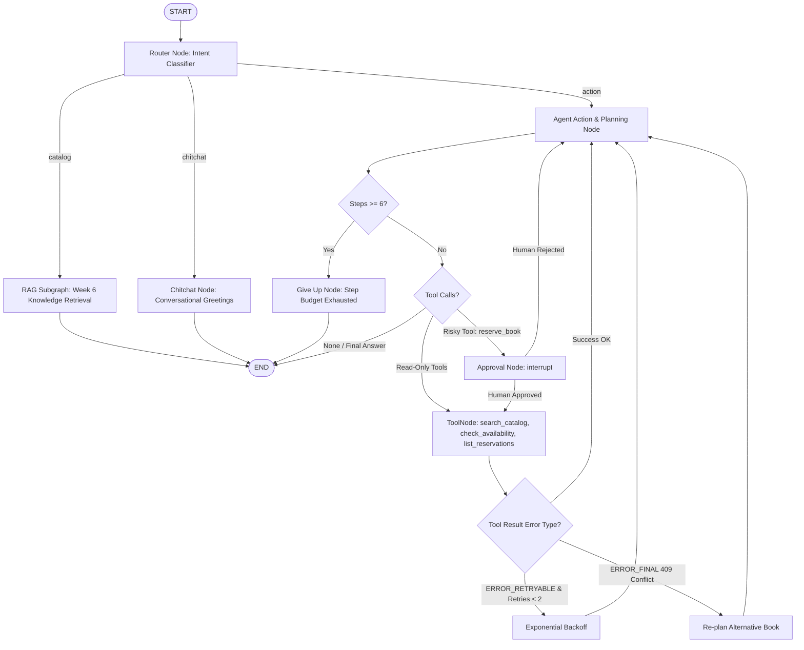

# 🏛️ Library Agent: Find, Approve, Reserve (Week 7 Final Project)

**Author:** Muhammad Qasim  
**Program:** AI Software Development Internship (.NET + Angular + AI)  
**Milestone:** Week 7 Final Project — Secure LangGraph Agents, Tool Execution, HITL, Persistence & CI  

[](https://www.python.org/)
[](https://langchain-ai.github.io/langgraph/)
[](https://dotnet.microsoft.com/)
[](https://angular.dev/)
[](https://fastapi.tiangolo.com/)
[](https://www.sqlite.org/)
[](https://ai.google.dev/)
[](https://github.com/)

---

## 📌 Executive Summary
The **Week 7 Final Project** elevates the Library AI system into an autonomous, stateful **LangGraph Agent** capable of searching catalog records, checking physical shelf availability, pausing for explicit Human-in-the-Loop (HITL) approval before executing book reservations, re-planning upon 409 conflict errors, and surviving browser refreshes via durable SQLite checkpoints.

---

## 🏗️ Multi-Tier Architecture & LangGraph Graph Topology



---

## 🛡️ Core Agent Tools & Least Privilege

All tools are implemented in [`ai-services/agent_tools.py`](ai-services/agent_tools.py) with Pydantic boundary validation:

1. **`search_catalog(query: str)`**:
   - Read-only tool searching catalog records. Safe for unbounded autonomous execution.
2. **`check_availability(book_id: int)`**:
   - Read-only tool validating that `book_id > 0` via `AvailabilityArgs(gt=0)`.
3. **`reserve_book(book_id: int)`**:
   - High-risk write tool creating reservations. Requires human approval intercept.
   - Extracts user JWT and idempotency keys strictly from `RunnableConfig` (never persisted in state).
4. **`list_my_reservations()`**:
   - Read-only account tool scoped to caller identity.

---

## 🔁 Typed Retries & Re-planning Path

- **Transient Failures (`ERROR_RETRYABLE`)**:
  - Automatically retried up to 2 times with exponential backoff ($0.5 \times (\text{retries} + 1)$ seconds).
- **Reservation Conflict (`ERROR_FINAL: 409 Conflict`)**:
  - The agent detects the conflict and does NOT loop. It immediately invokes `search_catalog` to recommend alternative available books in the same genre.
- **Global Step Limit**:
  - Hard limit of `MAX_STEPS = 6` routes to `give_up_node` preventing infinite tool execution loops.

---

## 🚀 Running the Project

### 1. Backend (.NET 8 Web API)
```bash
cd backend
dotnet run
```

### 2. AI Services (FastAPI + LangGraph)
```bash
cd ai-services
python main.py
```

### 3. Frontend (Angular 18/20)
```bash
cd frontend
npm start
```
