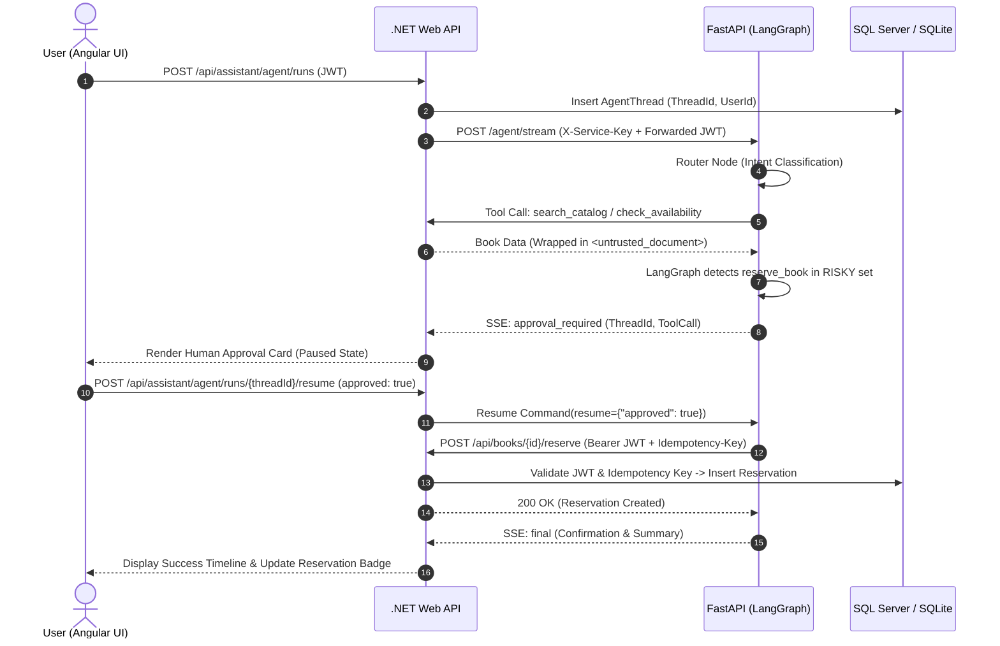

# Week 7 Capstone Project: Autonomous Library Agent (Find, Approve, Reserve)

## Project Overview
The Week 7 Capstone Project delivers an end-to-end, multi-tier autonomous library assistant that safely interacts with database systems to search catalog records, check real-time availability, solicit interactive human authorization, and securely commit book reservations.

---

## Directory Organization
- `backend/`: ASP.NET Core 8 Web API with EF Core, JWT authentication, idempotency verification, and SSE streaming run endpoints.
- `ai-services/`: FastAPI service hosting the compiled LangGraph agent, `SqliteSaver` checkpointer, and secure tool executors.
- `frontend/`: Angular 17+ standalone application featuring the live agent activity timeline, SSE connection manager, and interactive Human-in-the-Loop approval cards.

---

## Live Demo Test Matrix
Mentors will execute live verification against the following scenarios:
1. **Happy Path**: Search -> Availability -> Human Approval Card -> Approve -> Single Reservation Created.
2. **Conflict Recovery**: Reserve returns 409 -> Agent detects conflict, replans, searches alternative without looping.
3. **Rejection**: User rejects approval -> Zero reservations created, polite follow-up.
4. **Poisoned Description**: Injected instruction inside catalog text is safely neutralized.
5. **Circuit Breaker**: Terminating FastAPI returns clean error without hanging frontend.
6. **Persistence Refresh**: Browser reload during paused approval properly restores the pending card.
7. **Thread Hijacking**: Non-owner accessing another user's thread receives 404 Not Found.
8. **Double Approve**: Rapid double-clicking on approve button safely produces exactly one reservation.
