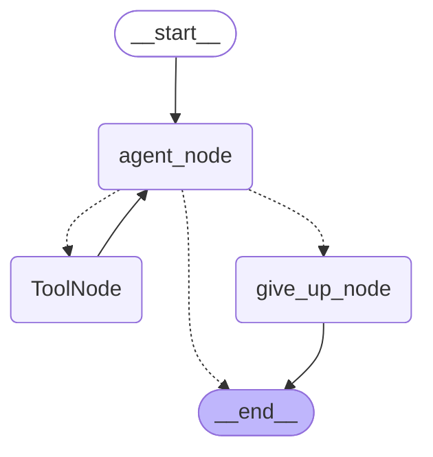

# Week 7 - Part A: Agent Fundamentals & LangGraph Core

## Executive Summary & Architecture Blueprint
Part A establishes the fundamental paradigm shift from **fixed sequential pipelines (LCEL chains)** to **autonomous stateful graphs (LangGraph)**.



---

## 1. Chatbot vs. Chain vs. Agent

| Dimension | Chatbot | Chain (LCEL) | Autonomous Agent (LangGraph) |
| :--- | :--- | :--- | :--- |
| **Control Flow** | Direct input -> model -> reply | Hardcoded sequence designed at build time | Dynamic cycle determined at run time |
| **Tool Calling** | None | Fixed single-invocation or zero | Iterative multi-tool selection in a loop |
| **Error Recovery** | Fails or hallucinates | Immediate cascade break | Observes error, re-plans, retries, or recovers |
| **Termination** | 1 turn | Completes when pipeline terminates | Requires explicit guards to prevent infinite loops |

---

## 2. LangGraph State Machine Specification
The agent state is defined as an explicit dictionary type:
```python
class AgentState(TypedDict):
    messages: Annotated[List[BaseMessage], add_messages] # Append-only reducer
    steps: int                                           # Scalar overwrite counter
```

### Key Reducer Concepts:
- **`add_messages`**: Rather than replacing message history on each step, new messages (`AIMessage`, `ToolMessage`, `HumanMessage`) are appended cleanly, preserving full trace lineage.
- **Overwriting Counters**: Scalar properties like `steps` and `retries` overwrite their predecessor value upon every update.

---

## 3. Loop Termination Guarantees & Step Budgets
Agents must never be permitted to loop indefinitely or exhaust API budgets:
```python
def route_after_agent(state: AgentState):
    if state["steps"] >= MAX_STEPS:
        return "give_up"
    return "tools" if state["messages"][-1].tool_calls else END
```
- When `steps >= MAX_STEPS`, control routes to `give_up_node`, which emits a polite, informative response explaining that the step budget was exhausted, rather than crashing or freezing.

---

## 4. Implementation Location
The complete, production-ready implementation of this architecture is built directly into our centralized capstone application at:
- Core Engine: [`Week_07_Final_Project/ai-services/agent_graph.py`](file:///d:/Courses%20and%20Internship/Internship/Completed/Internship-by-azeem/Week_wise_sol/All%20Week%20Tasks%20Sol/Week_07/Week_07_Final_Project/ai-services/agent_graph.py)
- Standalone Verification Script: [`Week_07_PartA_AgentFundamentals/agent_demo.py`](file:///d:/Courses%20and%20Internship/Internship/Completed/Internship-by-azeem/Week_wise_sol/All%20Week%20Tasks%20Sol/Week_07/Week_07_PartA_AgentFundamentals/agent_demo.py)
