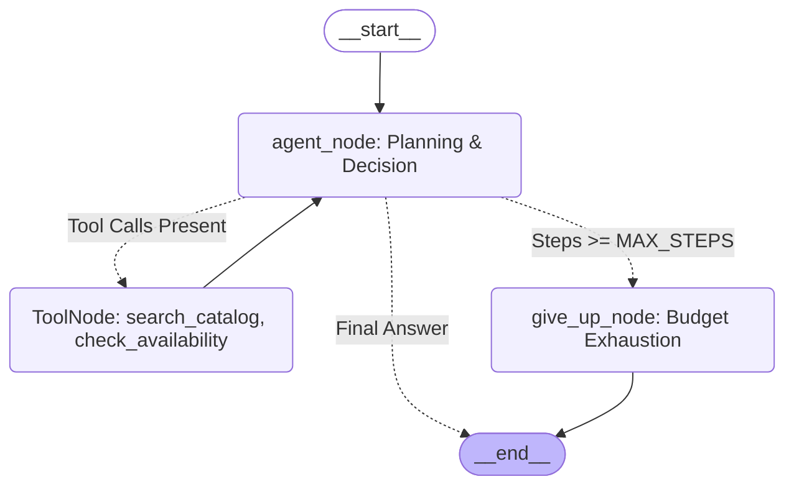

# Week 7 — Part A: Agent Fundamentals & LangGraph Core

## 📌 Executive Summary
Part A establishes the fundamental paradigm shift from **fixed sequential pipelines (LCEL chains)** to **autonomous stateful graphs (LangGraph)**.

This module implements:
1. **Explicit Graph State**: Typed state (`AgentState`) utilizing append-only reducers (`add_messages`) for message history and overwrite fields for step counters.
2. **Dynamic Cyclic Flow**: Autonomous agent loop dynamically choosing whether to return an answer or dispatch tools.
3. **Deterministic Loop Termination**: Strict step budget (`MAX_STEPS = 6`) terminating infinite cycles via `give_up_node`.
4. **Standalone Verification Harness**: Runnable script demonstrating agent convergence, tool calling, and step exhaustion defenses.

---

## 🏗️ Architecture & Graph Topology



---

## 🔑 Core Concepts Mastered

### 1. Chatbot vs. Chain vs. Autonomous Agent

| Dimension | Chatbot | Chain (LCEL) | Autonomous Agent (LangGraph) |
| :--- | :--- | :--- | :--- |
| **Control Flow** | Direct input -> model -> reply | Hardcoded sequence designed at build time | Dynamic cycle determined at run time |
| **Tool Calling** | None | Fixed single-invocation or zero | Iterative multi-tool selection in a loop |
| **Error Recovery** | Fails or hallucinates | Immediate cascade break | Observes error, re-plans, retries, or recovers |
| **Termination** | 1 turn | Completes when pipeline terminates | Requires explicit guards to prevent infinite loops |

### 2. LangGraph State Machine Specification
The agent state is defined as an explicit dictionary type:
```python
class AgentState(TypedDict):
    messages: Annotated[List[BaseMessage], add_messages] # Append-only reducer
    steps: int                                           # Scalar overwrite counter
```

- **`add_messages` Reducer**: Appends new messages (`AIMessage`, `ToolMessage`, `HumanMessage`), preserving complete reasoning lineage.
- **Overwriting Counters**: Scalar properties like `steps` and `retries` overwrite their predecessor value upon every update.

### 3. Loop Termination Guarantees & Step Budgets
Agents must never be permitted to loop indefinitely or exhaust API budgets:
```python
def route_after_agent(state: AgentState):
    if state["steps"] >= MAX_STEPS:
        return "give_up"
    return "tools" if state["messages"][-1].tool_calls else END
```
- When `steps >= MAX_STEPS`, control routes to `give_up_node`, emitting an informative response rather than crashing or freezing.

---

## 🛠️ Implementation Details (`agent_demo.py`)

- **Standalone Script:** [`Week_07_PartA_AgentFundamentals/agent_demo.py`](file:///d:/Courses%20and%20Internship/Internship/Completed/Internship-by-azeem/Week_wise_sol/All%20Week%20Tasks%20Sol/Week_07/Week_07_PartA_AgentFundamentals/agent_demo.py)
- **Central Capstone Module:** [`Week_07_Final_Project/ai-services/agent_graph.py`](file:///d:/Courses%20and%20Internship/Internship/Completed/Internship-by-azeem/Week_wise_sol/All%20Week%20Tasks%20Sol/Week_07/Week_07_Final_Project/ai-services/agent_graph.py)
- **Verification Command:**
  ```bash
  python Week_07_PartA_AgentFundamentals/agent_demo.py
  ```

---

## ✅ Verification Checklist
- [x] State machine graph compiled with `START`, `agent`, `tools`, `give_up`, and `END`.
- [x] `add_messages` reducer cleanly preserves multi-turn conversational traces.
- [x] Hard ceiling enforced (`MAX_STEPS = 6`), preventing infinite tool execution loops.
- [x] `give_up_node` gracefully catches runaway loops and informs the user.
