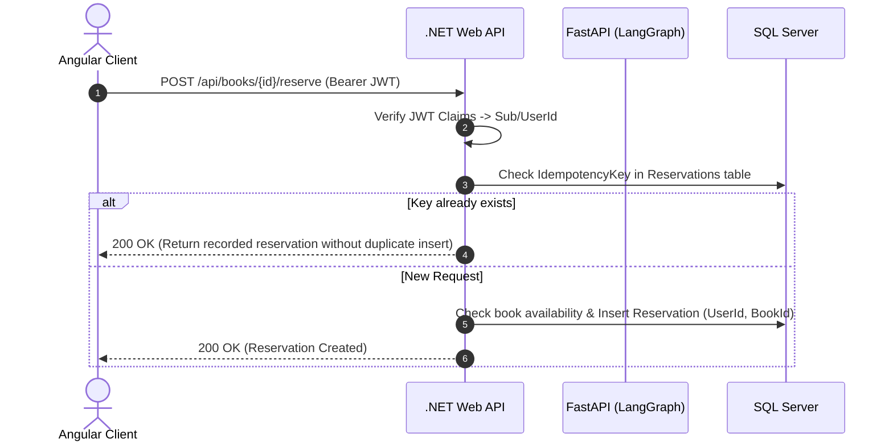

# Week 7 - Part B: Tool Design & Secure Tool Execution

## Executive Summary & Architecture Blueprint
Part B establishes enterprise-grade tool execution protocols where autonomous agents interact with persistent databases under strict security, validation, and authorization boundaries.

---

## 1. Core Tool Design Axioms

### A. Tool Descriptions are System Prompts
The LLM selects tools based entirely on their name, docstring, and parameter schema. Vague descriptions lead to tool hallucination or improper parameter injection.
```python
@tool("reserve_book", args_schema=ReserveArgs)
def reserve_book(book_id: int, config: RunnableConfig) -> str:
    """Reserve a book for the CURRENT USER.
    Only call after the user has clearly asked to reserve it.
    This changes data and requires human authorization."""
```

### B. Strict Pydantic Schema Validation
Inputs are validated by Pydantic before any network or database call is initiated:
```python
class ReserveArgs(BaseModel):
    book_id: int = Field(gt=0, description="Numeric ID of the book to reserve. Must be positive.")
```
Non-positive integers or SQL injection strings (e.g., `-1`, `4; DROP TABLE`) are rejected instantly with a 422/ValidationError.

---

## 2. Security Boundaries: Acting *as* the User, Not *above* the User



### Why JWTs Must Never Enter Graph State:
- LangGraph checkpointers serialize state objects directly to disk/tables (`agent_checkpoints.sqlite`).
- If an authorization token resides in `AgentState`, it is permanently persisted, readable by trace viewers, and vulnerable to checkpoint leaks.
- **Enforced Solution**: Pass the user token exclusively through `config["configurable"]["user_token"]`. It exists during execution but is never persisted into the checkpoint snapshot.

---

## 3. Idempotency Key Specification
To safeguard against network drops, retries, and rapid double-clicks:
- The caller generates or provides an `Idempotency-Key` header (`f"{key}:{book_id}"`).
- ASP.NET Core checks `Reservations.FirstOrDefaultAsync(r => r.IdempotencyKey == key)`.
- If found, the server returns the existing record with `200 OK`, guaranteeing that duplicate writes are impossible.

---

## 4. Error Handling: Data vs. Exceptions
- **Raw Exceptions**: Crash the entire LangGraph execution, resulting in an unrecoverable 500 error.
- **Errors as Data**: Returning `"ERROR_RETRYABLE: timeout"` or `"ERROR_FINAL: book already reserved"` allows the model to reason about the failure, re-plan alternative books, or notify the user gracefully.

---

## 5. Implementation Location
All production code for Part B is implemented directly in:
- .NET Controllers & Models: [`Week_07_Final_Project/backend/Controllers/BooksController.cs`](file:///d:/Courses%20and%20Internship/Internship/Completed/Internship-by-azeem/Week_wise_sol/All%20Week%20Tasks%20Sol/Week_07/Week_07_Final_Project/backend/Controllers/BooksController.cs) and [`Week_07_Final_Project/backend/Models/Reservation.cs`](file:///d:/Courses%20and%20Internship/Internship/Completed/Internship-by-azeem/Week_wise_sol/All%20Week%20Tasks%20Sol/Week_07/Week_07_Final_Project/backend/Models/Reservation.cs)
- Secure Tool Implementations: [`Week_07_Final_Project/ai-services/agent_tools.py`](file:///d:/Courses%20and%20Internship/Internship/Completed/Internship-by-azeem/Week_wise_sol/All%20Week%20Tasks%20Sol/Week_07/Week_07_Final_Project/ai-services/agent_tools.py)
