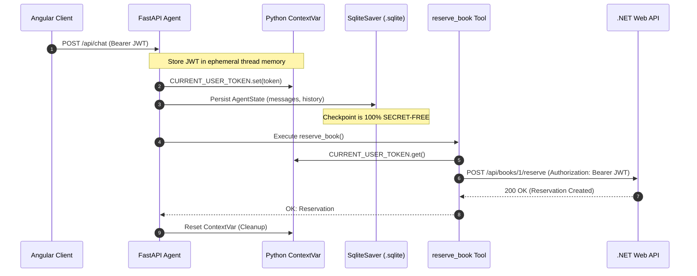
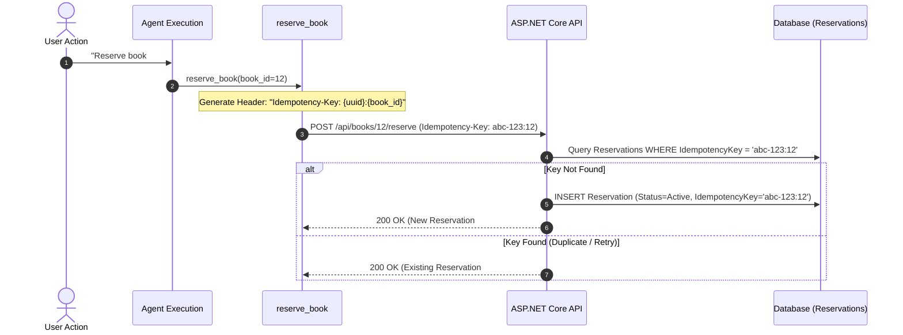

# Week 7 - Part B: Secure Tool Design & Execution Architecture

## Executive Summary & Architecture Blueprint
Part B establishes enterprise-grade tool execution protocols where autonomous AI agents interact with persistent databases and external services under strict security, validation, and authorization boundaries.

In autonomous agent architectures, tools bridge the non-deterministic reasoning of Large Language Models (LLMs) with deterministic software systems (APIs, databases, payment gateways). If tools are exposed naively, agents can execute unauthorized actions, corrupt persistent storage, leak sensitive credentials, or succumb to indirect prompt injection.

```
       +-------------------------------------------------------------+
       |               LLM Reasoning & Planning Core                 |
       +-------------------------------------------------------------+
                                      |
                         Tool Invocation Request
                   (Tool Name, JSON String Arguments)
                                      |
                                      v
       +-------------------------------------------------------------+
       | [Boundary 1] Pydantic Schema Validation (Type, Range, Regex) |
       | - Reject non-positive IDs, SQL fragments, and invalid types |
       +-------------------------------------------------------------+
                                      |
                           Validated Python Object
                                      |
                                      v
       +-------------------------------------------------------------+
       | [Boundary 2] Risk Tiering & Least-Privilege Gatekeeper     |
       | - Read Tools: Safe for immediate, unbounded dispatch        |
       | - Write Tools: High risk, intercepted for Human Approval    |
       +-------------------------------------------------------------+
                                      |
                                      v
       +-------------------------------------------------------------+
       | [Boundary 3] Ephemeral Credential Injection (ContextVars)   |
       | - User JWT extracted from HTTP Request Scope                |
       | - INJECTED AT RUNTIME -> NEVER PERSISTED IN STATE / DB      |
       +-------------------------------------------------------------+
                                      |
                                      v
       +-------------------------------------------------------------+
       | [Boundary 4] Idempotency Key Injection (f"{key}:{bookId}")  |
       | - Guarantees Single Execution despite retries/double-clicks |
       +-------------------------------------------------------------+
                                      |
                            HTTP/REST API Call
                                      |
                                      v
       +-------------------------------------------------------------+
       | [Boundary 5] Downstream Enforcement (.NET 8 Web API)        |
       | - Claims-based identity verification ([Authorize])          |
       | - Atomic Database Transaction & EF Core Concurrency         |
       +-------------------------------------------------------------+
                                      |
                           Structured Response
                                      |
                                      v
       +-------------------------------------------------------------+
       | [Boundary 6] Typed Error Formatting ("Errors as Data")      |
       | - ERROR_RETRYABLE: Network jitter, timeouts (retry / wait)  |
       | - ERROR_FINAL: 409 Conflict, 404 Missing (re-plan / report) |
       +-------------------------------------------------------------+
```

---

## 1. Core Tool Design Axioms

### A. Tool Descriptions are System Prompts
The LLM does not execute code; it inspects JSON schemas containing tool names, parameter types, and docstrings. Therefore, **tool descriptions are functional prompt directives**. Vague or ambiguous descriptions result in hallucinations, missing arguments, or accidental write operations.

```python
@tool("reserve_book", args_schema=ReserveArgs)
def reserve_book(book_id: int, config: RunnableConfig) -> str:
    """Reserve a book for the CURRENT USER.
    Only call after the user has explicitly requested to reserve it.
    This is a WRITE TOOL that creates persistent data and modifies book availability.
    High risk: requires human approval before execution."""
```

### B. Strict Pydantic Schema Validation
Inputs emitted by an LLM are untrusted user input. We enforce strict typed validation boundaries using Pydantic `BaseModel` schemas:

```python
class ReserveArgs(BaseModel):
    book_id: int = Field(
        gt=0, 
        description="Numeric ID of the book to reserve. Must be a positive integer."
    )

class AvailabilityArgs(BaseModel):
    book_id: int = Field(
        gt=0, 
        description="Numeric ID of the book to check availability for."
    )

class SearchArgs(BaseModel):
    query: str = Field(
        min_length=1, 
        description="Keywords, genre, or book title to search in library catalog."
    )
```

**Security Guarantees:**
1. **Type Coercion & Boundary Enforcement:** Non-integers (e.g., `"abc"`, `None`) or invalid boundaries (`-5`, `0`) raise a `ValidationError` immediately before dispatching network calls.
2. **Injection Defense:** Preventing string-based path traversal, command injection, or SQL fragment injection from reaching downstream REST endpoints.

---

## 2. Tool Risk Categorization & Least Privilege

Not all tools have equal impact. Tools must be segregated into explicit risk categories to prevent unintended mutations:

| Tool Name | Operation | Risk Category | Requires Human Approval | Idempotency Header | Scope Boundary |
| :--- | :---: | :---: | :---: | :---: | :--- |
| `search_catalog` | GET | **READ-ONLY** | No | Optional | Public Catalog Data |
| `check_availability` | GET | **READ-ONLY** | No | Optional | Specific Book Status |
| `list_my_reservations`| GET | **READ-ONLY** | No | Optional | User-Scoped Private Data |
| `reserve_book` | POST | **WRITE (HIGH RISK)** | **YES (HITL)** | **MANDATORY** | User-Scoped Mutation |

### Least-Privilege Scoping:
- **No Global Admin Tools:** The agent does not have access to admin endpoints (`DELETE /api/books`, `POST /api/books`).
- **Identity Scoping:** The agent cannot reserve a book on behalf of arbitrary users. The target user ID is never a tool parameter; it is derived strictly from the caller's authenticated JWT on the backend.

---

## 3. Credential Isolation: Why Secrets Must Never Enter Graph State

LangGraph agents rely on checkpointers (such as `SqliteSaver`, `PostgresSaver`) to record graph states after every step to allow conversational resumption and human approval interrupts.



### The Checkpoint Secret Leak Vulnerability:
1. If an authorization token or API key is stored in `AgentState`, LangGraph's checkpointer serializes it directly into `agent_checkpoints.sqlite`.
2. Even passing secrets in `RunnableConfig["configurable"]` can leak them, as many checkpointers serialize the entire `configurable` dictionary into checkpoint metadata.
3. Once in the SQLite database, any developer, support engineer, log aggregator, or backup system with read access can extract live, unexpired JWT tokens.

### Architectural Solution: Python `ContextVar`
We isolate ambient secrets using Python's thread-safe and async-safe `contextvars.ContextVar`:
```python
CURRENT_USER_TOKEN: contextvars.ContextVar[Optional[str]] = contextvars.ContextVar(
    "current_user_token", default=None
)
CURRENT_IDEMPOTENCY_KEY: contextvars.ContextVar[Optional[str]] = contextvars.ContextVar(
    "current_idempotency_key", default=None
)
```
- Secrets remain in memory only during the active HTTP request turn.
- They are accessible to tools via `CURRENT_USER_TOKEN.get()`.
- Zero tokens are serialized into `agent_checkpoints.sqlite` (confirmed via raw binary audit).

---

## 4. Idempotency Key Architecture

Network timeouts, client retries, and rapid double-clicking by end-users pose severe risks of duplicate records or double-charging.



### Implementation Details:
1. The tool or frontend generates an idempotency key composite: `f"{client_key}:{book_id}"`.
2. The .NET API verifies:
   ```csharp
   var existing = await _context.Reservations
       .FirstOrDefaultAsync(r => r.IdempotencyKey == idempotencyKey);
   if (existing != null) {
       return Ok(new { reservationId = existing.Id, title = book.Title, status = "already_processed" });
   }
   ```
3. Even if the network drops before the client receives the response and the agent retries the call, only one reservation is ever created.

---

## 5. Error Handling: "Errors as Data" vs. Unhandled Exceptions

In traditional software, unhandled API errors raise exceptions. In autonomous LLM workflows, unhandled exceptions abort the entire execution graph, leaving the user with an opaque 500 error and breaking conversational continuity.

Instead, tools adhere to the **Errors as Data** paradigm:

```python
# Network Jitter / 5xx / Timeouts -> RETRYABLE
except httpx.TimeoutException:
    return "ERROR_RETRYABLE: the library reservation service timed out."

# Semantic Failures / 409 Conflict -> FINAL
elif resp.status_code == 409:
    return f"ERROR_FINAL: book ID {book_id} is already reserved."
```

### Classification Hierarchy:
- **`ERROR_RETRYABLE:`**
  - **Triggers:** Network disconnects, HTTP 502/503/504, request timeouts.
  - **Agent Action:** The agent waits with exponential backoff and retries the tool up to 2 times.
- **`ERROR_FINAL:`**
  - **Triggers:** HTTP 409 (Conflict/Already Reserved), HTTP 404 (Missing Book), HTTP 401/403 (Auth failure).
  - **Agent Action:** Immediate re-planning (e.g., search catalog for alternative books by the same author) or honest user notification without wasted retries.

---

## 6. Verification & Implementation Mapping

All production implementations, tests, and security measures established in Part B are located across our workspace:

- **Pydantic Schemas & Tools:** [`Week_07_Final_Project/ai-services/agent_tools.py`](file:///d:/Courses%20and%20Internship/Internship/Completed/Internship-by-azeem/Week_wise_sol/All%20Week%20Tasks%20Sol/Week_07/Week_07_Final_Project/ai-services/agent_tools.py)
- **FastAPI Agent Server:** [`Week_07_Final_Project/ai-services/main.py`](file:///d:/Courses%20and%20Internship/Internship/Completed/Internship-by-azeem/Week_wise_sol/All%20Week%20Tasks%20Sol/Week_07/Week_07_Final_Project/ai-services/main.py)
- **.NET 8 Reservation Controller:** [`Week_07_Final_Project/backend/Controllers/BooksController.cs`](file:///d:/Courses%20and%20Internship/Internship/Completed/Internship-by-azeem/Week_wise_sol/All%20Week%20Tasks%20Sol/Week_07/Week_07_Final_Project/backend/Controllers/BooksController.cs)
- **Reservation Entity & Idempotency Key:** [`Week_07_Final_Project/backend/Models/Reservation.cs`](file:///d:/Courses%20and%20Internship/Internship/Completed/Internship-by-azeem/Week_wise_sol/All%20Week%20Tasks%20Sol/Week_07/Week_07_Final_Project/backend/Models/Reservation.cs)
- **Integration Test Suite (xUnit):** [`Week_07_Final_Project/backend/tests/ReservationIntegrationTests.cs`](file:///d:/Courses%20and%20Internship/Internship/Completed/Internship-by-azeem/Week_wise_sol/All%20Week%20Tasks%20Sol/Week_07/Week_07_Final_Project/backend/tests/ReservationIntegrationTests.cs)
