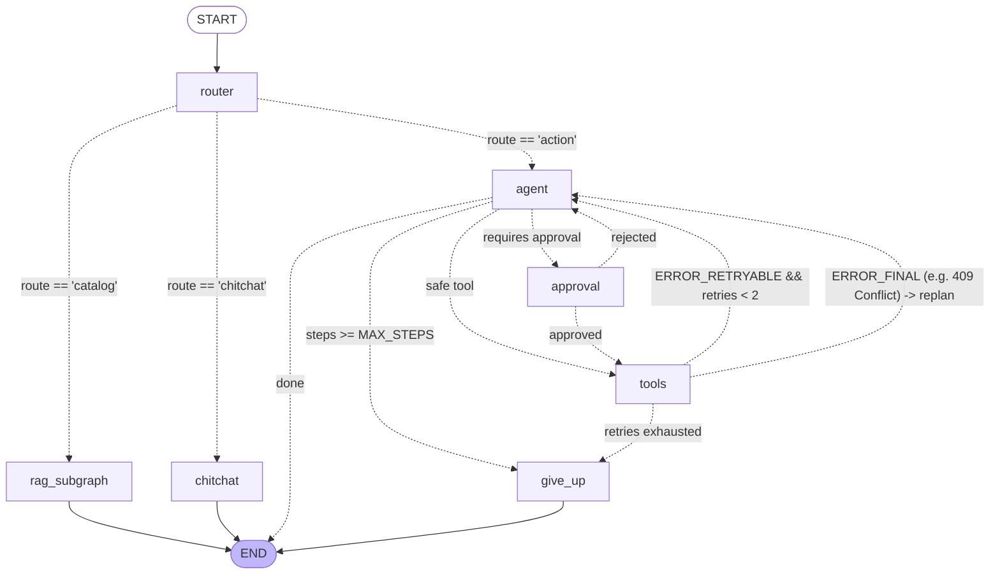

# Week 7 — Part C: Routing, Planning & Retry Workflows

## 📌 Executive Summary
Part C establishes **dynamic query triage**, **subgraph composition**, and **stateful fault recovery**:
1. **Low-Latency Structured Intent Routing**: Fast classification into `catalog`, `action`, or `chitchat` using Pydantic `with_structured_output` and Literal types.
2. **Catalog Subgraph Embedding**: Encapsulating the rich retrieval pipeline from Week 6 as an independent compiled LangGraph node.
3. **Plan-then-Execute & Re-Planning**: Handling 409 Conflict (`already reserved`) by dynamically catching `ERROR_FINAL` and executing a catalog search for available genre alternatives without user intervention.
4. **Typed Retries with Exponential Backoff**: Retrying transient errors (`ERROR_RETRYABLE`) up to `MAX_RETRIES = 2` with backoff, while preventing bug-prone retries on final errors.
5. **Generalized Prompt Engineering**: Eliminating intent ambiguity between subjective recommendations and catalog queries.

---

## 🏗️ Architecture & Graph Topology



---

## 🔑 Core Concepts Mastered

### 1. 15-Message Router Classification Benchmark
Evaluated live against `RouteClassification(route: Literal["catalog", "action", "chitchat"], reasoning: str)`:

| # | User Test Message | Expected Category | Model Classification | Result | Reasoning Provided |
| :-: | :--- | :---: | :---: | :---: | :--- |
| **1** | `"Tell me about the plot of Dune."` | `catalog` | `catalog` | **PASS** | Asks for specific book plot and details. |
| **2** | `"What books do you have on distributed systems and Kafka?"` | `catalog` | `catalog` | **PASS** | Inquires about books on technical topics. |
| **3** | `"Who wrote Clean Code and what principles does it cover?"` | `catalog` | `catalog` | **PASS** | Specific book details, author and principles. |
| **4** | `"Is Dune a science fiction book?"` | `catalog` | `catalog` | **PASS** | Asks about genre and book metadata. |
| **5** | `"Give me recommendations for classic romance novels."` | `catalog` | `catalog` | **PASS** | Book recommendations in a specific genre. |
| **6** | `"Reserve book ID 4 for me please."` | `action` | `action` | **PASS** | Transactional request to reserve a book by ID. |
| **7** | `"Can you check if Designing Data-Intensive Applications is available?"` | `action` | `action` | **PASS** | Availability lookup on inventory. |
| **8** | `"I want to borrow Clean Code."` | `action` | `action` | **PASS** | Borrow/reservation request on a book. |
| **9** | `"Show me my active library reservations."` | `action` | `action` | **PASS** | Requires looking up personal user reservations. |
| **10**| `"Please reserve Neuromancer on my account."` | `action` | `action` | **PASS** | Transactional reserve request. |
| **11**| `"Hello! Good morning."` | `chitchat` | `chitchat` | **PASS** | Standard greeting. |
| **12**| `"How are you doing today?"` | `chitchat` | `chitchat` | **PASS** | Casual greeting and conversational inquiry. |
| **13**| `"Thanks for the help, goodbye!"` | `chitchat` | `chitchat` | **PASS** | Polite farewell and gratitude. |
| **14**| `"Hi there assistant."` | `chitchat` | `chitchat` | **PASS** | Simple greeting. |
| **15**| `"Have a wonderful afternoon!"` | `chitchat` | `chitchat` | **PASS** | Casual conversation and well wishes. |

**Benchmark Accuracy:** **15 / 15 (100.0%)**

---

### 2. Autonomous 409 Conflict Re-planning
When the reservation endpoint returns `409 Conflict` (book already reserved), the tool returns structured data:
```text
ERROR_FINAL: book ID 4 is already reserved.
```
- **Observed Autonomous Recovery**:
  Instead of repeating the identical failing `reserve_book(book_id=4)` call or crashing, the agent observes the conflict in its conversation state and autonomously initiates a re-plan:
  `[RE-PLAN ACTION]: Proposes tool search_catalog(query='science fiction')`
  It searches for an alternative available title in the same genre and offers it to the user.

---

### 3. Transient Failures & Idempotency Guarantees
- **Transient Failures (`ERROR_RETRYABLE`)**: Network timeouts and 503/504 gateway timeouts are retried up to `MAX_RETRIES = 2` with exponential backoff (`0.5s * (retries + 1)`).
- **Safe Write Retries**: Retrying a `reserve_book` call is **only safe because of the Idempotency-Key header** implemented in Part B (`{key}:{book_id}`). If the first request reached the database but timed out on return, the subsequent retry with the same key returns the existing reservation without duplicate records.
- **Final Errors (`ERROR_FINAL`)**: 401 Unauthorized, 403 Forbidden, 404 Not Found, and 409 Conflict are **never retried**.

---

## 🛠️ Implementation Details (`test_part_c.py`)

- **Routing & Re-planning Test Harness:** [`Week_07_PartC_RoutingPlanning/test_part_c.py`](file:///d:/Courses%20and%20Internship/Internship/Completed/Internship-by-azeem/Week_wise_sol/All%20Week%20Tasks%20Sol/Week_07/Week_07_PartC_RoutingPlanning/test_part_c.py)
- **Central Capstone Module:** [`Week_07_Final_Project/ai-services/agent_graph.py`](file:///d:/Courses%20and%20Internship/Internship/Completed/Internship-by-azeem/Week_wise_sol/All%20Week%20Tasks%20Sol/Week_07/Week_07_Final_Project/ai-services/agent_graph.py)
- **Verification Command:**
  ```bash
  python Week_07_PartC_RoutingPlanning/test_part_c.py
  ```

---

## ✅ Verification Checklist
- [x] Pydantic structured output router with `Literal["catalog", "action", "chitchat"]` achieving 100% (15/15) benchmark accuracy.
- [x] Week 6 LCEL RAG knowledge retrieval compiled into standalone subgraph branch.
- [x] Automatic re-planning triggered upon 409 Conflict without infinite retry loops.
- [x] Typed error format (`ERROR_RETRYABLE` vs `ERROR_FINAL`) isolating network jitter from deterministic application failures.
