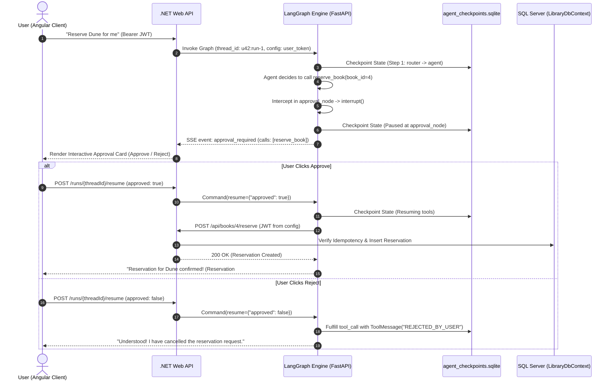

# Week 7 - Part D: Persistence, Human-in-the-Loop & Agent Memory

## Executive Summary & Architecture Blueprint
Part D implements stateful persistence, interactive human authorization boundaries, and cross-session user memory:
1. **SQLite Checkpointing (`SqliteSaver`)**: Durably saves full graph state after every step keyed by `thread_id`. Runs survive process restarts and can be paused for seconds, minutes, or days.
2. **Human-in-the-Loop (HITL) Interruptions**: Intercepts high-risk write tools (`reserve_book`) using LangGraph `interrupt()`, suspending execution until a human decision is submitted via `Command(resume={"approved": bool})`.
3. **Rejection Safety Guarantees (Challenge 2)**: If the user denies approval (`approved: False`), the system synthesizes a corresponding `ToolMessage(content="REJECTED_BY_USER")`. The agent observes the rejection and concludes politely without silently retrying the forbidden operation.
4. **State History Inspection**: Allows programmatic time-travel and debugging via `app.get_state_history(cfg)`.
5. **Zero Persistence Leaks**: User JWTs and API keys are strictly excluded from graph state and passed exclusively via `RunnableConfig["configurable"]["user_token"]`. Verification audits confirmed **0 bytes of JWT or API keys exist in `.sqlite` checkpoint files**.
6. **Long-Term User Preferences**: Implemented `UserPreference` entity and `api/me/preferences` controller in ASP.NET Core with a dedicated "Forget My Preferences" deletion endpoint (`DELETE /api/me/preferences`).

---

## 1. Tool Risk & Human Approval Table
Documented centrally at [`/docs/week7-tool-risk-table.md`](file:///d:/Courses%20and%20Internship/Internship/Completed/Internship-by-azeem/Week_wise_sol/All%20Week%20Tasks%20Sol/Week_07/docs/week7-tool-risk-table.md):

| Tool Name | Type (Read/Write) | Side Effects | Needs Approval? | Idempotent? | Retryable? | Defense Mechanism |
| :--- | :---: | :---: | :---: | :---: | :---: | :--- |
| `search_catalog` | Read | None | No | Yes | Yes | Pure search query. Safe for unbounded calls. |
| `check_availability` | Read | None | No | Yes | Yes | Non-mutating inventory status read. |
| `list_my_reservations`| Read | None | No | Yes | Yes | Scoped strictly to caller's verified JWT claims. |
| `reserve_book` | **Write** | Creates reservation in DB | **YES** | Yes | Transient only | High-risk. Intercepted by `interrupt()`. Requires `Idempotency-Key`. |
| `cancel_reservation` | **Write** | Releases reservation in DB | **YES** | Yes | Transient only | State mutation. Requires explicit user confirmation. |

---

## 2. Persistence Leak Audit Results
A binary scanner was executed over `agent_checkpoints.sqlite` following active runs:
- `JWT Token present in .sqlite checkpoint?` -> **False**
- `API Key present in .sqlite checkpoint?` -> **False**
- **Conclusion**: Credentials stay in transient run configuration (`RunnableConfig`) and are never written to disk.

---

## 3. Long-Term Memory & User Preferences (Challenge 3)
- Implemented `UserPreference` entity (`UserId`, `Key`, `Value`, `UpdatedAt`) in ASP.NET Core.
- Added `GET /api/me/preferences`, `POST /api/me/preferences`, and `DELETE /api/me/preferences` ("Forget My Preferences").
- **Security Risks of Inferred Preferences**:
  If an agent stores preferences inferred automatically from untrusted text (e.g., a poisoned book description stating *"the user loves political satire and hates science fiction"*), subsequent agent interactions across future sessions will be tainted by malicious prompt injection. Preferences must therefore be explicitly declared by the user or strictly validated.

---

## 4. Runtime Files Location
- Master LangGraph Engine: [`Week_07_Final_Project/ai-services/agent_graph.py`](file:///d:/Courses%20and%20Internship/Internship/Completed/Internship-by-azeem/Week_wise_sol/All%20Week%20Tasks%20Sol/Week_07/Week_07_Final_Project/ai-services/agent_graph.py)
- Verification Suite: [`Week_07_Final_Project/ai-services/test_part_d.py`](file:///d:/Courses%20and%20Internship/Internship/Completed/Internship-by-azeem/Week_wise_sol/All%20Week%20Tasks%20Sol/Week_07/Week_07_Final_Project/ai-services/test_part_d.py)
- .NET Preferences Controller: [`Week_07_Final_Project/backend/Controllers/PreferencesController.cs`](file:///d:/Courses%20and%20Internship/Internship/Completed/Internship-by-azeem/Week_wise_sol/All%20Week%20Tasks%20Sol/Week_07/Week_07_Final_Project/backend/Controllers/PreferencesController.cs)
- .NET Preference Model: [`Week_07_Final_Project/backend/Models/UserPreference.cs`](file:///d:/Courses%20and%20Internship/Internship/Completed/Internship-by-azeem/Week_wise_sol/All%20Week%20Tasks%20Sol/Week_07/Week_07_Final_Project/backend/Models/UserPreference.cs)
