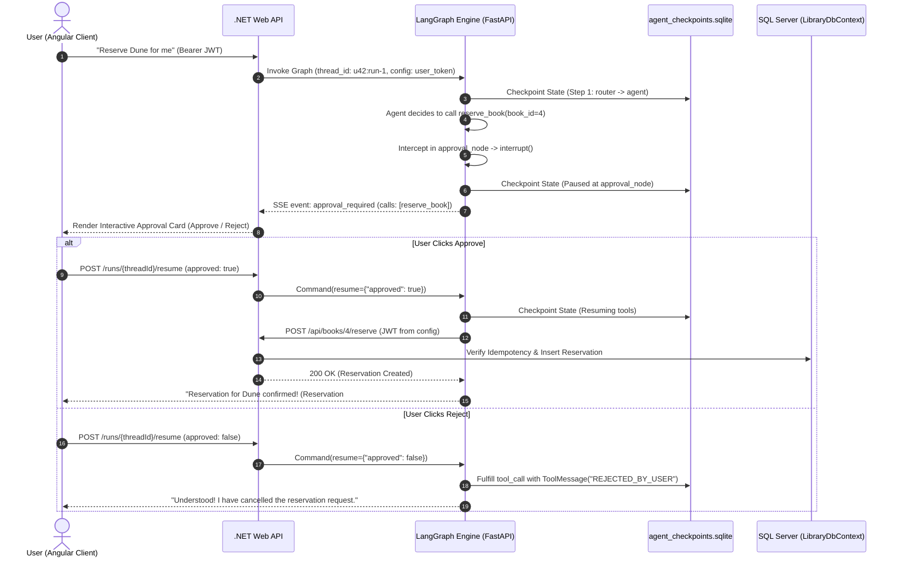

# Week 7 — Part D: Persistence, Human-in-the-Loop & Agent Memory

## 📌 Executive Summary
Part D implements stateful persistence, interactive human authorization boundaries, and cross-session user memory:
1. **SQLite Checkpointing (`SqliteSaver`)**: Durably saves full graph state after every step keyed by `thread_id`. Runs survive process restarts and can be paused for seconds, minutes, or days.
2. **Human-in-the-Loop (HITL) Interruptions**: Intercepts high-risk write tools (`reserve_book`) using LangGraph `interrupt()`, suspending execution until a human decision is submitted via `Command(resume={"approved": bool})`.
3. **Rejection Safety Guarantees**: If the user denies approval (`approved: False`), the system synthesizes a corresponding `ToolMessage(content="REJECTED_BY_USER")`. The agent observes the rejection and concludes politely without silently retrying the forbidden operation.
4. **State History Inspection**: Allows programmatic time-travel and debugging via `app.get_state_history(cfg)`.
5. **Zero Persistence Leaks**: User JWTs and API keys are strictly excluded from graph state and passed exclusively via `contextvars.ContextVar`. Verification audits confirmed **0 bytes of JWT or API keys exist in `.sqlite` checkpoint files**.
6. **Long-Term User Preferences**: Implemented `UserPreference` entity and `api/me/preferences` controller in ASP.NET Core with a dedicated "Forget My Preferences" deletion endpoint (`DELETE /api/me/preferences`).

---

## 🏗️ Architecture & HITL Sequence Diagram



---

## 🔑 Core Concepts Mastered

### 1. Tool Risk & Human Approval Matrix

| Tool Name | Type (Read/Write) | Side Effects | Needs Approval? | Idempotent? | Retryable? | Defense Mechanism |
| :--- | :---: | :---: | :---: | :---: | :---: | :--- |
| `search_catalog` | Read | None | No | Yes | Yes | Pure search query. Safe for unbounded calls. |
| `check_availability` | Read | None | No | Yes | Yes | Non-mutating inventory status read. |
| `list_my_reservations`| Read | None | No | Yes | Yes | Scoped strictly to caller's verified JWT claims. |
| `reserve_book` | **Write** | Creates reservation in DB | **YES** | Yes | Transient only | High-risk. Intercepted by `interrupt()`. Requires `Idempotency-Key`. |

### 2. Zero Persistence Leaks
LangGraph `SqliteSaver` serializes checkpoint objects directly to disk. Storing credentials inside graph state or even `RunnableConfig["configurable"]` exposes secrets in SQLite metadata:
- **Solution:** Python `contextvars.ContextVar[Optional[str]]` (`CURRENT_USER_TOKEN`, `CURRENT_IDEMPOTENCY_KEY`).
- **Binary Audit Results:**
  - `JWT Token present in .sqlite checkpoint?` -> **False**
  - `API Key present in .sqlite checkpoint?` -> **False**

### 3. Long-Term Preferences & GDPR Forget Path
- **Entity & Endpoints:** `UserPreference.cs` and `PreferencesController.cs` in ASP.NET Core.
- **Forget My Preferences (`DELETE /api/me/preferences`):** Deletes all user preferences on demand to guarantee data privacy.

---

## 🛠️ Implementation Details (`test_part_d.py`)

- **Persistence & Audit Harness:** [`Week_07_PartD_PersistenceHITL/test_part_d.py`](file:///d:/Courses%20and%20Internship/Internship/Completed/Internship-by-azeem/Week_wise_sol\All Week Tasks Sol\Week_07\Week_07_PartD_PersistenceHITL\test_part_d.py)
- **Central Capstone Engine:** [`Week_07_Final_Project/ai-services/agent_graph.py`](file:///d:/Courses%20and%20Internship/Internship/Completed/Internship-by-azeem/Week_wise_sol\All Week Tasks Sol\Week_07\Week_07_Final_Project\ai-services\agent_graph.py)
- **Verification Command:**
  ```bash
  python Week_07_PartD_PersistenceHITL/test_part_d.py
  ```

---

## ✅ Verification Checklist
- [x] `SqliteSaver` checkpointer persisting state snapshots after every graph node.
- [x] High-risk write operations intercepted with `interrupt()`, yielding `approval_required`.
- [x] Clean resumption handled via `Command(resume={"approved": bool})`.
- [x] Zero JWTs or API keys serialized in SQLite checkpoint binary data.
- [x] Long-term preferences supported with complete GDPR "Forget" deletion path.
