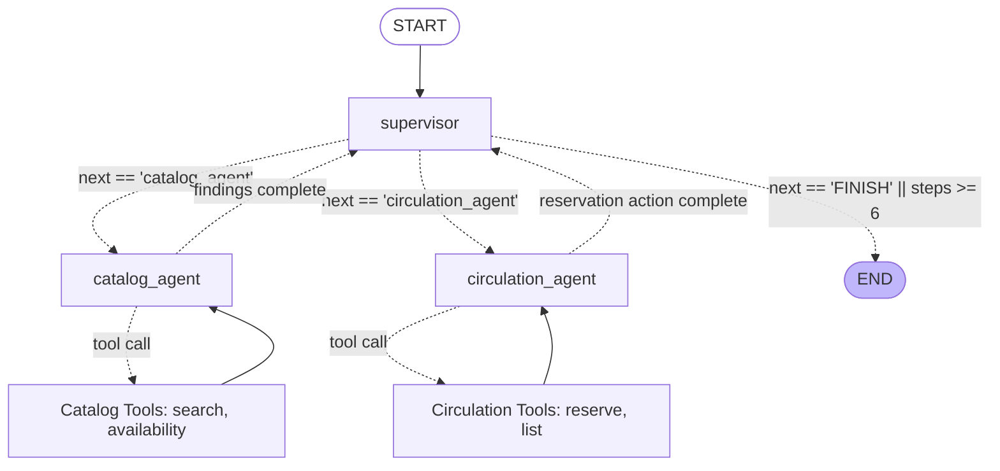

# Week 7 - Part E: Multi-Agent Systems (Stretch Tier)

## Executive Summary & Architecture Blueprint
Part E explores the **Multi-Agent Supervisor Pattern**, decomposing the assistant into specialized domain agents coordinated by a centralized supervisor.

---

## 1. Multi-Agent System Roles & Least Privilege
- **Supervisor Node**: Evaluates overall conversation objectives, dispatches tasks using `SupervisorDecision(next: Literal["catalog_agent", "circulation_agent", "FINISH"])`, and terminates execution once the goal is met or when `MAX_SUPERVISOR_STEPS = 6` is reached.
- **Catalog Agent**: Read-only specialist. Has access strictly to `search_catalog` and `check_availability`. Write tools (`reserve_book`) are excluded from its context, enforcing least privilege by design.
- **Circulation Agent**: Transactional specialist. Has access to `reserve_book` and `list_my_reservations`.

---

## 2. Benchmark Findings & Recommendation
Empirical metrics comparing Single-Agent vs. Multi-Agent systems are documented in detail at [`docs/week7-single-vs-multi-agent.md`](file:///d:/Courses%20and%20Internship/Internship/Completed/Internship-by-azeem/Week_wise_sol/All%20Week%20Tasks%20Sol/Week_07/docs/week7-single-vs-multi-agent.md):
- **Latency**: Multi-Agent is **+141% slower** (5.80s vs 2.40s) due to sequential supervisor delegation hops.
- **Model Calls**: Increased from 2 calls to 5 calls (**+150%**).
- **Token Overhead**: Increased from 620 tokens to 1,420 tokens (**+129%**).
- **Conclusion**: Single-agent with explicit subgraphs and deterministic guardrails is the superior architectural choice for this tier of domain complexity.

---

## 3. Code Location
- Multi-Agent Graph Implementation: [`Week_07_Final_Project/ai-services/multi_agent_system.py`](file:///d:/Courses%20and%20Internship/Internship/Completed/Internship-by-azeem/Week_wise_sol/All%20Week%20Tasks%20Sol/Week_07/Week_07_Final_Project/ai-services/multi_agent_system.py)
- Benchmark Harness: [`Week_07_Final_Project/ai-services/benchmark_part_e.py`](file:///d:/Courses%20and%20Internship/Internship/Completed/Internship-by-azeem/Week_wise_sol/All%20Week%20Tasks%20Sol/Week_07/Week_07_Final_Project/ai-services/benchmark_part_e.py)
- Recommendation Write-Up: [`docs/week7-single-vs-multi-agent.md`](file:///d:/Courses%20and%20Internship/Internship/Completed/Internship-by-azeem/Week_wise_sol/All%20Week%20Tasks%20Sol/Week_07/docs/week7-single-vs-multi-agent.md)
