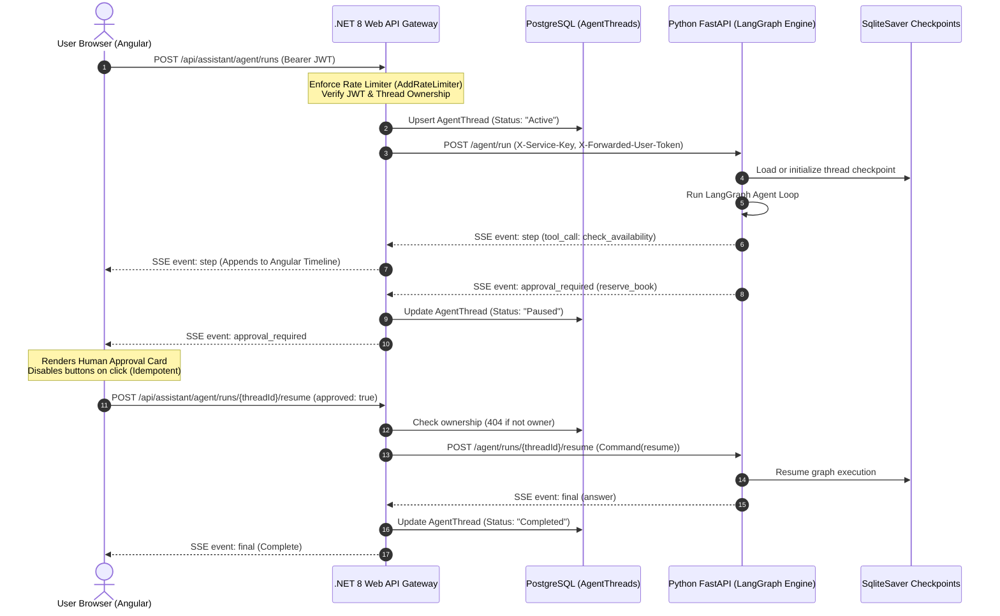

# Week 7 — Part H: Full-Stack Integration (.NET Agent API & Angular Agent UI)

## Architectural Overview & Trust Boundaries

Part H establishes the full-stack interactive loop between the Angular single-page frontend, the ASP.NET Core 8 Web API gateway, and the Python FastAPI / LangGraph execution engine.

---

## 1. Trust Boundaries & Security Enforcements

1. **Browser to .NET Gateway**:
   - The Angular frontend sends user credentials strictly via standard `Authorization: Bearer <JWT>` headers.
   - Per-user rate limiting is enforced with ASP.NET Core 8's built-in `AddRateLimiter` (`PerUserAgentPolicy`), partitioned by authenticated user ID (maximum 15 agent runs per minute). Excess requests immediately receive `429 Too Many Requests`.

2. **Strict Thread Ownership & Zero-Probing (404 over 403)**:
   - Every `AgentThread` is indexed by `ThreadId` and bound to the authenticated user's `UserId`.
   - If an unauthorized user attempts to probe, inspect (`GET /api/assistant/agent/runs/{threadId}`), resume (`POST /api/assistant/agent/runs/{threadId}/resume`), or cancel another user's thread, the gateway returns `404 Not Found` (never `403 Forbidden`). This prevents malicious attackers from enumerating valid thread IDs.

3. **.NET Gateway to FastAPI Service Boundary**:
   - FastAPI endpoints (`/agent/run`, `/agent/runs/{thread_id}/resume`, `/agent/runs/{thread_id}/cancel`, `/agent/runs/{thread_id}/state`) are isolated from direct public traffic.
   - Protected by a shared cryptographic header `X-Service-Key`. Requests lacking or presenting an invalid key receive `403 Forbidden`.
   - Forwarded user JWT is passed exclusively in `X-Forwarded-User-Token` during the transient request execution and is **never** persisted in agent state checkpoints or SQLite databases.

---

## 2. API Contract & Typed Server-Sent Events

### Endpoints
| HTTP Method | Route | Description | Security & Notes |
| :--- | :--- | :--- | :--- |
| `POST` | `/api/assistant/agent/runs` | Starts agent run, streams typed SSE events | Creates `AgentThread` row; returns `threadId` in first event; rate-limited |
| `POST` | `/api/assistant/agent/runs/{threadId}/resume` | Approves or rejects pending action | Body: `{ approved: bool }`; idempotent; owner-only (404 otherwise) |
| `GET` | `/api/assistant/agent/runs/{threadId}` | State recovery on page reload | Returns status + pending approval details; owner-only |
| `POST` | `/api/assistant/agent/runs/{threadId}/cancel` | Cancels running thread upstream | Aborts upstream LangGraph stream and token generation |

### SSE Events
| Event Name | JSON Payload Structure | UI Behavior |
| :--- | :--- | :--- |
| `step` | `{"event": "step", "kind": "tool_call" \| "tool_result" \| "thought", "name": string, "summary": string}` | Appends interactive trace item to timeline |
| `token` | `{"event": "token", "text": string}` | Progressively streams tokens into active bubble |
| `approval_required` | `{"event": "approval_required", "threadId": string, "calls": [{"name": string, "args": object}], "message": string}` | Renders Interactive Approval Card; run paused |
| `final` | `{"event": "final", "answer": string, "sources": string[]}` | Finalizes conversation bubble and marks run complete |
| `error` | `{"event": "error", "code": number, "message": string, "retryable": bool}` | Shows error notification; displays retry button if retryable |

---

## 3. Angular UI Features & Acceptance Behaviors

- **Interactive Execution Timeline**:
  - Displays agent decisions with dedicated color-coded badges (`🔧 Call`, `📋 Result`, `💡 Agent`).
- **Human-in-the-Loop Approval Card**:
  - Displays action details (e.g. `reserve_book(book_id=1)`).
  - Features immediate double-click protection: button disables on the first click and displays *"Processing..."*, guaranteeing client-side idempotency.
- **Refresh Survival**:
  - `ChatAssistantComponent.ngOnInit()` detects existing active thread IDs from `localStorage` and queries `GET /api/assistant/agent/runs/{threadId}` to automatically restore paused approval cards on browser refresh.
- **Upstream Cancellation**:
  - Clicking `⏹ Stop` fires `/api/assistant/agent/runs/{threadId}/cancel`, which sets an `asyncio.Event` in FastAPI to immediately terminate token generation.
