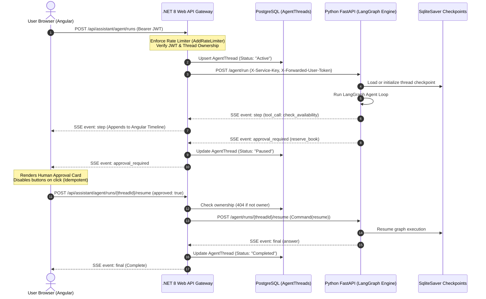

# Week 7 — Part H: Full-Stack Integration (.NET Agent API & Angular Agent UI)

## 📌 Executive Summary
Part H establishes the full-stack interactive loop between the Angular single-page frontend, the ASP.NET Core 8 Web API gateway, and the Python FastAPI / LangGraph execution engine.

This module implements:
1. **.NET 8 Gateway & Proxy Layer**: Exposing authenticated, rate-limited endpoints proxying typed SSE event streams from FastAPI.
2. **Anti-Probing Thread Isolation**: Rejecting unauthorized thread access with `404 Not Found` (never 403) to prevent ID enumeration.
3. **Interactive Angular UI**: Real-time agent thought/tool execution timeline, double-click protected approval cards, and page refresh state restoration.
4. **End-to-End Resilience**: Polly retry and circuit breaker policies, client disconnect handling, and upstream cancel events.

---

## 🏗️ Architecture & Full-Stack Request Flow

---

## 🔑 Core Concepts Mastered

### 1. API Contract & Typed Server-Sent Events

| Endpoint | Method | Purpose | Security Controls |
| :--- | :---: | :--- | :--- |
| `/api/assistant/agent/runs` | `POST` | Initiates agent run; streams SSE | `[Authorize]`, `AddRateLimiter` (15/min), JWT claim extraction |
| `/api/assistant/agent/runs/{threadId}/resume` | `POST` | Submits human approval decision | Strict thread ownership (404 on mismatch), idempotent |
| `/api/assistant/agent/runs/{threadId}` | `GET` | Restores thread on browser reload | Restores pending approval card without restarting run |
| `/api/assistant/agent/runs/{threadId}/cancel` | `POST` | Cancels active run upstream | Sets Python `asyncio.Event` to abort LLM token generation |

### 2. Angular Acceptance Behaviors
- **Execution Timeline**: Displays real-time tool calls (`🔧 Call`), backend returns (`📋 Result`), and thoughts (`💡 Agent`).
- **Interactive Approval Card**: Suspends conversation on write tools (`reserve_book`); buttons disable immediately upon click to prevent accidental double-submits.
- **Refresh State Recovery**: `ChatAssistantComponent.ngOnInit()` detects existing active thread IDs from `localStorage` and queries `/api/assistant/agent/runs/{threadId}` to automatically restore paused approval cards.

---

## 🛠️ Implementation Details

- **.NET Agent Controller:** [`Week_07_Final_Project/backend/Controllers/AssistantController.cs`](file:///d:/Courses%20and%20Internship/Internship/Completed/Internship-by-azeem/Week_wise_sol/All%20Week%20Tasks%20Sol/Week_07/Week_07_Final_Project/backend/Controllers/AssistantController.cs)
- **FastAPI SSE Gateway:** [`Week_07_Final_Project/ai-services/main.py`](file:///d:/Courses%20and%20Internship/Internship/Completed/Internship-by-azeem/Week_wise_sol/All%20Week%20Tasks%20Sol/Week_07/Week_07_Final_Project/ai-services/main.py)
- **Angular Component & Service:**
  - Component: [`Week_07_Final_Project/frontend/src/app/chat-assistant/chat-assistant.component.ts`](file:///d:/Courses%20and%20Internship/Internship/Completed/Internship-by-azeem/Week_wise_sol/All%20Week%20Tasks%20Sol/Week_07/Week_07_Final_Project/frontend/src/app/chat-assistant/chat-assistant.component.ts)
  - Service: [`Week_07_Final_Project/frontend/src/app/chat.service.ts`](file:///d:/Courses%20and%20Internship/Internship/Completed/Internship-by-azeem/Week_wise_sol/All%20Week%20Tasks%20Sol/Week_07/Week_07_Final_Project/frontend/src/app/chat.service.ts)

---

## ✅ Verification Checklist
- [x] Typed SSE streaming proxying `step`, `token`, `approval_required`, `final`, and `error` events.
- [x] Per-user rate limiting enforced using ASP.NET Core `AddRateLimiter`.
- [x] Thread ownership validated against database; non-owners receive `404 Not Found`.
- [x] Angular execution timeline renders interactive tool calls and result badges.
- [x] Approval card survives browser refresh and prevents double-click submissions.
