# Week 7 — Part I: Ecosystem Awareness (MCP, Semantic Kernel & Local Models)

## 📌 Executive Summary
Part I expands our architectural perspective across the modern AI systems landscape beyond single-framework agent patterns. We evaluate standard protocol discovery, alternative enterprise stacks, and cost-efficient inference models:

1. **Model Context Protocol (MCP)**:
   - Standardized client-server protocol (JSON-RPC) for decoupling tool execution from model orchestrators.
   - Cross-host interoperability (Claude Desktop, Antigravity IDE, custom agents).
   - Trust boundary and identity propagation trade-offs.

2. **Microsoft Semantic Kernel (.NET)**:
   - Native C#/.NET agent orchestration directly inside ASP.NET Core.
   - Enterprise Dependency Injection and Entity Framework Core direct integration vs. loss of cyclic graph checkpointing.

3. **Small Language Models (SLMs) & Local Inference**:
   - Quantized local models (e.g., Llama 3.2 3B or Phi-3 via Ollama) for zero-cost, low-latency deterministic intent classification.

---

## 🏗️ Architectural Ecosystem Comparison

```mermaid
graph TD
    subgraph "Current: Polyglot Architecture"
        WebAPI[ASP.NET Core Web API] <-->|HTTP / SSE| PythonAgent[LangGraph Engine]
        PythonAgent -->|In-Process Tools| Tools[agent_tools.py]
    end

    subgraph "Alternative 1: Model Context Protocol (MCP)"
        MCPHost[MCP Host Client] <-->|JSON-RPC 2.0 stdio/SSE| MCPServer[Library MCP Server]
        MCPServer --> EFCore[Direct DB Queries]
    end

    subgraph "Alternative 2: Monolithic C# Orchestration"
        KernelHost[ASP.NET Core API + Semantic Kernel] --> Plugins[Native C# Kernel Plugins]
        Plugins --> LocalDB[(PostgreSQL via EF Core)]
    end
```

---

## 🔑 Core Concepts Mastered

### 1. Model Context Protocol (MCP) vs. In-Process Tools
- **Paradigm Shift:** Moves from tightly coupled Python functions to a language-agnostic JSON-RPC client-server protocol.
- **Enterprise Benefits:** Standardized tool discovery, seamless sharing across multiple AI clients (Claude Desktop, Antigravity IDE, terminal assistants).
- **Security Boundaries:** Requires rigorous mTLS and per-call token propagation to prevent the "Confused Deputy" vulnerability where an MCP server executes writes under a shared elevated service account.

### 2. Microsoft Semantic Kernel (.NET) vs. LangGraph (Python)
- **C# Semantic Kernel:** Eliminates the polyglot microservice network boundary, inherits ambient `HttpContext.User` security contexts, and provides direct Entity Framework Core access.
- **Python LangGraph:** Delivers superior cyclic graph state machines, durable SQLite checkpointing (`SqliteSaver`), seamless `interrupt()` human approval gates, and integration with modern red-teaming/eval toolchains.

---

## 🛠️ Comprehensive Documentation Reports

- 📄 **[`docs/week7-mcp-vs-langchain-tools.md`](file:///d:/Courses%20and%20Internship/Internship/Completed/Internship-by-azeem/Week_wise_sol/All%20Week%20Tasks%20Sol/Week_07/docs/week7-mcp-vs-langchain-tools.md)**:
  - Deep-dive architectural comparison of in-process LangChain tools vs. MCP client-server protocol.
  - Detailed analysis of tool reuse, .NET domain integration, trust boundaries, token forwarding risks, and indirect prompt injection attack vectors.

- 📄 **[`docs/week7-semantic-kernel-comparison.md`](file:///d:/Courses%20and%20Internship/Internship/Completed/Internship-by-azeem/Week_wise_sol/All%20Week%20Tasks%20Sol/Week_07/docs/week7-semantic-kernel-comparison.md)**:
  - Detailed evaluation of Semantic Kernel vs. LangGraph.
  - Analyzes benefits of single-stack C# integration vs. the trade-offs in cyclic state management, time-travel debugging, and checkpoint persistence.
  - Formulates a strategic architecture recommendation defending why Nexa Solutions retains LangGraph for stateful HITL workflows while leveraging ASP.NET Core for gateway security.

---

## ✅ Verification Checklist
- [x] Comprehensive MCP vs. in-process tool architecture report authored.
- [x] Full Semantic Kernel (.NET) vs. LangGraph (Python) trade-off analysis documented.
- [x] Trust boundaries, token propagation risks, and "Confused Deputy" concerns evaluated.
- [x] Strategic enterprise deployment recommendations formulated.
