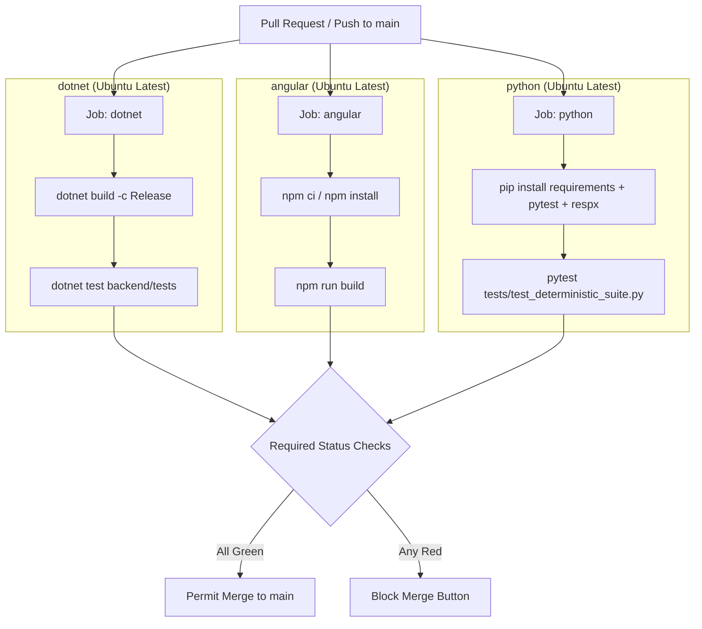

# Week 7 — Part J: Git & GitHub Continuous Integration and git bisect

## 1. Continuous Integration (CI) Architecture

Continuous Integration ensures that every Pull Request and commit pushed to `main` is automatically compiled and verified before merging. Our pipeline is defined at [`.github/workflows/ci.yml`](../../.github/workflows/ci.yml) and executes three parallel jobs matching our multi-platform stack:



### Required Status Checks & Branch Protection Setup
In GitHub Repository Settings (`Settings` → `Branches` → `Branch protection rules` on `main`):
1. **Require a pull request before merging**: Enforce at least 1 peer approval.
2. **Require status checks to pass before merging**: Check the box **"Require branches to be up to date before merging"**.
3. **Select the 3 exact job names**:
   - `Build & Test .NET Backend` (`dotnet`)
   - `Build Angular Frontend` (`angular`)
   - `Test Python AI Services (Deterministic Suite)` (`python`)
4. **Enforce administrators**: Ensure branch rules apply even to repository owners.

---

## 2. Secrets in CI vs. Why Real LLM Evaluations Belong in Offline Harnesses

### Critical Security Rule: Zero Live Secrets in CI Runs
Our CI tests run **purely deterministic mocked tests** using `respx` and fake client dependencies. No API keys (`GEMINI_API_KEY`, `OPENAI_API_KEY`) or JWT secrets are stored in repository files, environment configs, or required for PR runs from external forks.

### Why Running Real LLM Evaluations on Every Push is an Anti-Pattern:
1. **Cost Explosion**: Running a 20-scenario real LLM evaluation suite across multiple PR commits, re-runs, and branches can consume hundreds of thousands of tokens per developer per day, generating massive API bills.
2. **Nondeterminism & Flakiness**: Foundation models exhibit stochastic variance. Even with `temperature=0`, minor upstream updates or transient provider throttling can cause an arbitrary benchmark to fail, blocking developer deployments and eroding trust in the CI pipeline.
3. **Security & Fork Exposure**: Pull Requests from public forks cannot and should not have access to organization secrets (`GEMINI_API_KEY`). If a CI workflow required live API keys, PRs from forks would fail by default or risk exposing credentials to modified CI test scripts.
4. **Execution Latency**: Live LLM calls take seconds to minutes. CI pipelines must remain under 3–5 minutes for rapid developer feedback.

> [!NOTE]
> **Production Best Practice**: CI gates run fast, deterministic unit and integration tests (`tests/test_deterministic_suite.py` and `ReservationIntegrationTests.cs`). Full real-LLM evaluation suites (`tests/eval_suite.py`) are scheduled as nightly cron jobs or run manually prior to staging releases.

---

## 3. Automated Bug Isolation with `git bisect`

`git bisect` is a binary search tool built into Git that allows developers to find the exact commit that introduced a regression in $O(\log N)$ steps. If a regression was introduced somewhere in the last 50 commits, `git bisect` locates the offending commit in approximately 6 test runs instead of 50.

### Step-by-Step Procedure

1. **Start the Bisect Session**:
   ```bash
   git bisect start
   ```

2. **Mark the Current State as Bad**:
   ```bash
   git bisect bad
   ```

3. **Mark an Older Known Good State**:
   Provide a commit hash or tag known to pass all tests (e.g., commit from Week 6 baseline or Part A):
   ```bash
   git bisect good af1166d
   ```
   *Git will calculate the midpoint commit and automatically checkout that working tree.*

4. **Automate the Search with a Test Script**:
   Instead of manually testing each step, pass the deterministic test runner command to `git bisect run`:
   ```bash
   git bisect run D:/Software/PythonEnvironments/AI_env/Scripts/python.exe -m pytest Week_07/Week_07_Final_Project/ai-services/tests/test_deterministic_suite.py -q
   ```
   - If the command exits with code `0`, Git marks the commit as **good**.
   - If the command exits with code `1` (or non-zero), Git marks the commit as **bad**.
   - Git automatically repeats the binary search until it pins the exact commit:
     ```text
     [hash] is the first bad commit
     commit [hash]
     Author: Developer <dev@example.com>
     Date:   ...
         fix: accidentally modified reservation validator
     ```

5. **Reset the Bisect Session**:
   Once the bad commit is identified, return to the original branch:
   ```bash
   git bisect reset
   ```

6. **Remediate**:
   Create a dedicated hotfix branch, patch the offending logic, and open a PR verified by the GitHub Actions CI pipeline.
