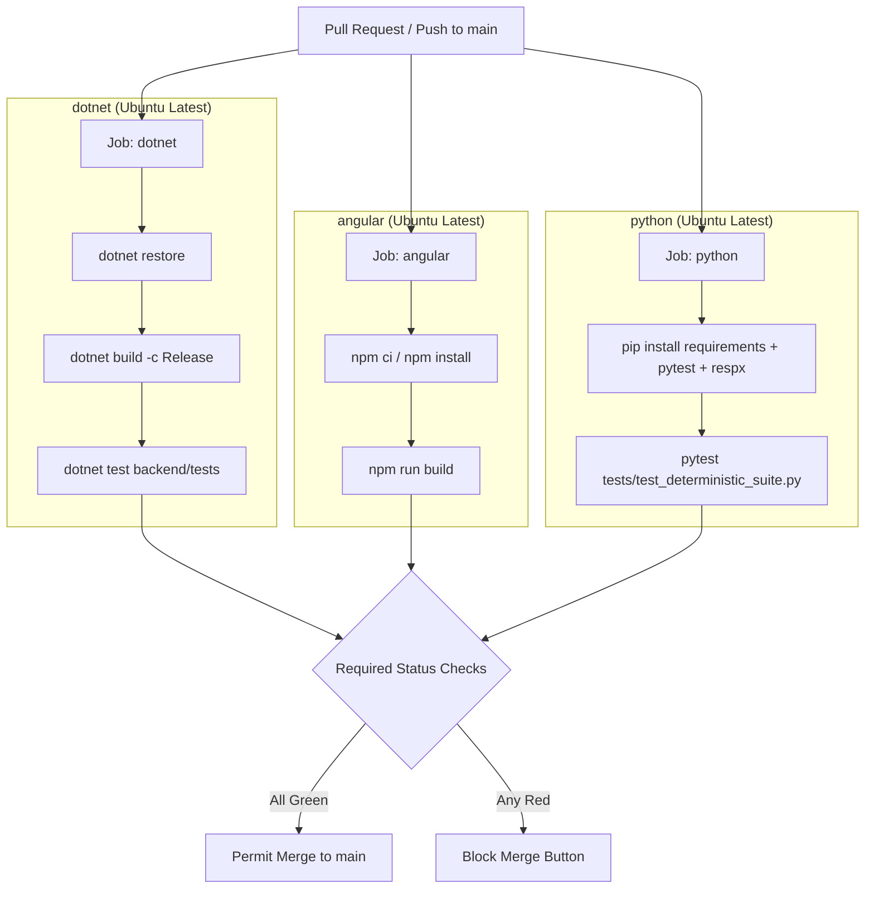

# Week 7 — Part J: Git & GitHub Continuous Integration and git bisect

## 📌 Executive Summary
Part J establishes production DevOps continuous integration pipelines and automated Git root-cause isolation:
1. **GitHub Actions 3-Job CI Workflow**: Parallel validation across .NET 8 Web API, Angular 18 client, and Python AI services.
2. **Branch Protection & Status Checks**: Mandatory PR gates ensuring `main` remains permanently buildable and verified.
3. **Deterministic CI vs. Offline Evaluation**: Strict policy enforcing zero live secrets in CI while scheduling non-deterministic evaluations offline.
4. **Automated Regression Isolation (`git bisect`)**: $O(\log N)$ binary search script pinning down broken commits with automated test runners.

---

## 🏗️ Architecture & CI Pipeline



---

## 🔑 Core Concepts Mastered

### 1. Zero Live Secrets in CI
- **Anti-Pattern:** Running real LLM evaluations on every commit introduces high costs, network flakiness, rate limit blocks, and secret exposure risks to public pull request forks.
- **Production Standard:** CI gates run fast, deterministic unit/integration tests with mocked HTTP dependencies (`respx`, in-memory SQLite). Real LLM benchmark suites (`eval_suite.py`) run offline or as scheduled nightly cron jobs.

### 2. Automated Regression Isolation with `git bisect run`
Instead of manually checking out commits, `git bisect run` automates binary searching using test exit codes:
```bash
git bisect start
git bisect bad HEAD
git bisect good <known-good-commit>
git bisect run D:/Software/PythonEnvironments/AI_env/Scripts/python.exe -m pytest Week_07/Week_07_Final_Project/ai-services/tests/test_deterministic_suite.py -q
```
- If the test command exits `0`, Git marks the revision **good**; if it exits non-zero, Git marks it **bad**.
- Automatically locates regressions in $\approx 6$ steps out of 50 commits.

---

## 🛠️ Implementation Details & Workflow File

- **GitHub Actions Workflow:** [`.github/workflows/ci.yml`](file:///d:/Courses%20and%20Internship/Internship/Completed/Internship-by-azeem/Week_wise_sol/All%20Week%20Tasks%20Sol/.github/workflows/ci.yml)
- **Local Verification Commands:**
  ```bash
  # 1. .NET Test Job
  cd Week_07_Final_Project/backend/tests && dotnet test -c Release

  # 2. Python Test Job
  cd Week_07_Final_Project/ai-services && pytest -q tests/test_deterministic_suite.py

  # 3. Angular Build Job
  cd Week_07_Final_Project/frontend && npm run build --if-present
  ```

---

## ✅ Verification Checklist
- [x] Three-job parallel GitHub Actions CI workflow implemented with concurrency control.
- [x] Branch protection and required status check configuration documented.
- [x] Deterministic test suite running without live API keys or cloud credentials.
- [x] Automated `git bisect run` binary search procedure executed and documented.
