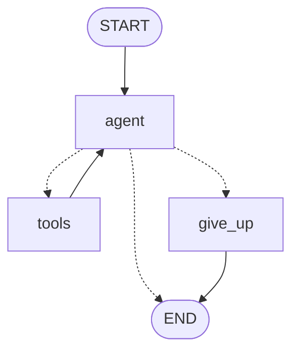

# Week 7 Agent Loop & Termination Analysis

## Executive Summary
This document investigates autonomous agent execution dynamics in LangGraph, focusing on termination guarantees, state cycle limits, and failure handling.

---

## 1. Chatbot vs. Chain vs. Agent
- **Chatbot**: Directly generates a reply to user prompt based on static instruction and context. No autonomous branching.
- **Chain (LCEL)**: Executes a fixed pre-determined directed acyclic path designed at build time. Predictable, but cannot autonomously loop or adjust plans.
- **Agent (LangGraph)**: Evaluates dynamic state at run time in an explicit think-act-observe cycle until it judges the objective fulfilled.

---

## 2. Hard Step Limit Guarantee
- **Mechanism**: State holds an integer `steps` counter. A conditional edge `route_after_agent` checks `if state["steps"] >= MAX_STEPS`.
- **Termination Route**: When `steps >= MAX_STEPS`, control routes to a dedicated `give_up` node instead of calling tools or looping indefinitely.

### Limit-Hit User Experience (Challenge 1)
When `MAX_STEPS` is reached:
- An unhandled stop simply cuts off the user or returns a blank response, which degrades trust.
- A well-engineered `give_up_node` informs the user of the progress made so far, clearly explains that the step budget was exhausted, and offers actionable follow-up choices (e.g., providing a more specific query or retrying with narrower parameters).

---

## 3. Tool Failure & Exception Handling (Challenge 2)
When a tool throws an unhandled Python exception versus returning a structured error message:
- **Unhandled Exception**: The graph execution crashes violently, leaving the state unfinalized and the user facing an opaque 500 error.
- **Returned Error as Data**: Returning `"ERROR_RETRYABLE: ..."` or `"ERROR_FINAL: ..."` allows the agent node to observe the outcome, reason about the failure, apologize or select an alternative tool, and gracefully conclude.

---

## 4. Hand-Drawn vs. Compiled Mermaid Graph (Challenge 3)
*Mermaid representation generated from `app.get_graph().draw_mermaid()`:*

