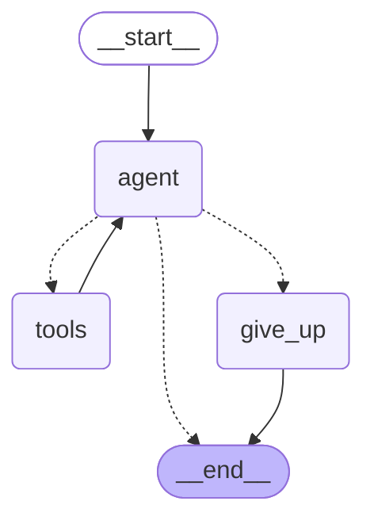

# Week 7 Agent Loop & Termination Analysis

## Executive Summary
This document investigates autonomous agent execution dynamics in LangGraph, focusing on termination guarantees, state cycle limits, and failure handling under empirical execution.

---

## 1. Chatbot vs. Chain vs. Agent
- **Chatbot**: Directly generates a reply to a user prompt based on static instruction and conversational history. It cannot branch dynamically or call external services based on run-time conditions.
- **Chain (LCEL)**: Executes a fixed, pre-determined sequence designed at build time (e.g., `retriever | format_docs | prompt | model | parser`). Predictable and fast, but cannot autonomously loop, recover from intermediate failures, or select different actions.
- **Agent (LangGraph)**: Evaluates dynamic state at run time in an explicit think-act-observe cycle (`agent_node` -> `ToolNode` -> `agent_node`) until it judges the objective fulfilled. Autonomy enables dynamic reasoning and recovery, but introduces the risk of non-termination, resource exhaustion, and infinite tool looping.

---

## 2. Empirical Execution Trace
**Prompt**: `"Find a science fiction book and tell me if it is available."`

```text
[USER PROMPT]: Find a science fiction book and tell me if it is available.
[THOUGHT / TOOL CALL]: [{'name': 'search_books', 'args': {'genre_or_title': 'science fiction'}}]
[TOOL OBSERVATION] (search_books): Found: 'Dune' by Frank Herbert (ID: 101, Genre: Sci-Fi)
[THOUGHT / TOOL CALL]: [{'name': 'check_availability', 'args': {'book_id': 101}}]
[TOOL OBSERVATION] (check_availability): Book ID 101 is AVAILABLE (2 copies on shelf).
[AGENT ANSWER]: I found the science fiction book "Dune" by Frank Herbert (Book ID: 101). It is currently available to borrow, with 2 copies on the shelf.
Total steps taken: 3
```

---

## 3. Challenge 1: Enforcing Step Limits (`MAX_STEPS = 2`)
When running the same multi-step query with `MAX_STEPS = 2`:
- **Observed Behavior**:
  ```text
  [RESULT UNDER STEP LIMIT]: I could not finish this within my step limit. Please clarify your request or try again.
  Steps recorded: 2
  ```
- **Analysis**:
  Because finding a book and verifying its stock requires at least 2 tool steps (`search_books` -> observation -> `check_availability` -> observation -> final answer), a hard limit of `MAX_STEPS = 2` terminates the graph at the `agent` conditional edge before completion.
- **User Experience Assessment**:
  Simply terminating or printing an abrupt error is unacceptable in production. A well-designed `give_up_node` should:
  1. Summarize intermediate findings discovered before the limit (e.g., *"I found 'Dune' (ID: 101), but ran out of steps before confirming shelf availability"*).
  2. Clearly disclose why execution stopped rather than silently failing.
  3. Provide an actionable follow-up button or suggestion (e.g., *"Would you like me to check availability for Dune now?"*).

---

## 4. Challenge 2: Unhandled Exception in Tool Execution
- **Prediction**: When `failing_tool` raises an unhandled `RuntimeError`, the tool node execution raises an exception up the call stack, halting the entire LangGraph invocation abruptly and preventing subsequent state transitions.
- **Observed Outcome**:
  ```text
  Predicting behavior: Tool will raise RuntimeError; unhandled exception will propagate unless caught in node.
  Outcome (Observed): Graph execution halted abruptly with exception: RuntimeError: Simulated internal hardware/network crash in failing_tool!
  ```
- **Architectural Conclusion**:
  Tools must **never raise raw exceptions** for expected or operational errors. Instead:
  - Errors must be returned as structured data strings (e.g., `"ERROR_RETRYABLE: timeout"` or `"ERROR_FINAL: book not found"`).
  - This allows the model to observe the failure in message history, reason about alternatives, or apologize politely without crashing the host process.

---

## 5. Challenge 3: Hand-Drawn vs. Compiled Mermaid Graph
Compiled directly from `app.get_graph().draw_mermaid()`:



### Hand-Drawn vs. Compiled Comparison:
- **What the hand-drawn version missed**: Hand-drawn sketches frequently omit the explicit back-edge from `tools` directly to `agent`, mistakenly visualizing tools connecting directly to `__end__` or passing output straight to the user. The compiled graph makes it clear that the tool node's output must cycle back to the model for cognitive observation and synthesis.
