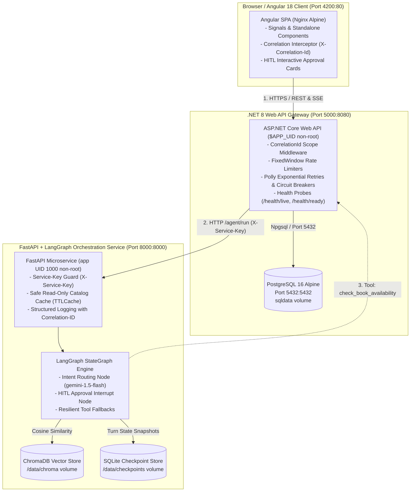

# 🏛️ Week 8: Capstone Final Polish, Performance, Reliability, Security & Packaging

**Program:** AI Software Development Internship (.NET + Angular + AI)  
**Author:** Muhammad Qasim  
**Milestone:** Week 8 of 8 (Final Capstone) — Production Hardening, Verification & Release v1.0.0  

[](https://dotnet.microsoft.com/)
[](https://angular.dev/)
[](https://fastapi.tiangolo.com/)
[](https://langchain-ai.github.io/langgraph/)
[](https://www.docker.com/)
[](./CHANGELOG.md)

---

## 🌟 Executive Overview

**Week 8 is the Capstone Production Milestone.** Having designed full-stack reactive applications, RAG pipelines, and autonomous LangGraph agents in Weeks 1–7, Week 8 tests something fundamentally different:  
*Can you take a complex system that runs on your local machine and transform it into a containerized, observable, hardened, and reproducible enterprise platform that another engineer or stakeholder can run, trust, measure, and maintain with a single command?*

### The Core Guarantees of Week 8
1. **Measured Performance & Caching:** Content-hash incremental vector indexing; safe in-memory read-only catalog answer caching (`TTLCache`) returning instant responses with 0 token consumption; token budget enforcement.
2. **Reliability & Observability:** Unified `X-Correlation-Id` across Angular, ASP.NET Core, and FastAPI; liveness (`/health/live`) vs. readiness (`/health/ready`); Polly retries and circuit breakers on every outbound hop.
3. **Defense-in-Depth Security:** Automated dependency vulnerability scans (`dotnet list package --vulnerable`, `npm audit`, `pip-audit`), whole-history Git secret scanning (`gitleaks`), locked-down CORS, login rate limiting, and GDPR-compliant `DELETE /api/users/{id}/data`.
4. **Zero-Friction Packaging:** Multi-stage Dockerfiles, non-root execution (`USER app`, `USER $APP_UID`), container start ordering via healthchecks, persistent volumes (`sqldata`, `aidata`), and single-command startup (`docker compose up --build`).
5. **Quality Gates & Release:** 20-scenario evaluation harness executed 3 times (60 trials total), 0 unapproved writes, approved release criteria, semantic versioning, and formal v1.0.0 release.

---

## 📐 System Architecture & Container Topology



---

## 🛠️ Tooling & Environment Requirements

Consistent toolchain paths applied across development, CI, and local verification:
- **.NET SDK:** `D:\Software\dotnet\dotnet.exe` (.NET 8.0 SDK)
- **Python Virtualenv:** `D:\Software\PythonEnvironments\AI_env\Scripts\python.exe` (Python 3.12+)
- **Package Manager:** `D:\Software\PythonEnvironments\AI_env\Scripts\pip.exe`
- **Git Binary:** `D:\Software\Git\cmd\git.exe`
- **Container Engine:** Docker Desktop / Docker Compose v2.20+

---

## 🚀 Quick Start (Clean Machine in 3 Steps)

### 1. Environment Configuration
Copy the template configuration and supply your LLM provider API keys:
```bash
cp .env.example .env
```
*(All database credentials, ports, and internal keys are preconfigured for instant zero-config startup).*

### 2. Multi-Container Launch
Start all services (PostgreSQL, FastAPI AI Orchestrator, .NET Web API, and Angular Client) with automatic dependency health waiting:
```bash
docker compose up --build
```

### 3. Verification & Live Endpoints
- **Angular Web Client:** [http://localhost:4200](http://localhost:4200)
  - **Demo User:** `demo_user` / `DemoUser123!` (Role: `User`)
  - **Admin User:** `admin` / `Admin123!` (Role: `Admin`)
- **ASP.NET Core Web API:** [http://localhost:5000/swagger](http://localhost:5000/swagger)
- **API Health Probes:** [http://localhost:5000/health/live](http://localhost:5000/health/live) & [http://localhost:5000/health/ready](http://localhost:5000/health/ready)
- **FastAPI AI Engine:** [http://localhost:8000/docs](http://localhost:8000/docs) & [http://localhost:8000/health](http://localhost:8000/health)

---

## ⚙️ Configuration Reference (`.env`)

| Variable Name | Default Value | Description |
| :--- | :--- | :--- |
| `POSTGRES_DB` | `librarydb_week3` | PostgreSQL database catalog name |
| `POSTGRES_USER` | `postgres` | Database superuser account name |
| `POSTGRES_PASSWORD` | `private` | Database authentication secret |
| `JWT_KEY` | `SuperSecretWeek08Production...` | High-entropy (256-bit) token signing key |
| `SERVICE_KEY` | `sec-auth-token-internal...` | Shared secret header for inter-service security |
| `GEMINI_API_KEY` | *(Your Key)* | Primary driver for LangGraph reasoning & embeddings |
| `RUN_MIGRATIONS` | `true` | Triggers schema creation and `DatabaseSeeder.cs` |
| `DAILY_TOKEN_BUDGET`| `25000` | Per-user token consumption ceiling |

---

## 📂 Modular Structure & Documentation Index

| Directory / File | Scope & Focus | Primary Deliverables |
| :--- | :--- | :--- |
| **[`CHANGELOG.md`](./CHANGELOG.md)** | Semantic Versioning Release Notes | Full changelog for production release `v1.0.0`. |
| **[`docker-compose.yml`](./docker-compose.yml)** | Multi-Service Mesh Definition | PostgreSQL, AI service, API, and Angular with healthchecks. |
| **[`docs/architecture.md`](./docs/architecture.md)** | System Architecture Guide | Trust boundaries, component topology, sequence diagrams, and ADR links. |
| **[`docs/runbook.md`](./docs/runbook.md)** | Operations & SRE Runbook | Start/stop commands, health endpoints, triage guides, and key rotation. |
| **[`docs/user-guide.md`](./docs/user-guide.md)** | End-User Documentation | Natural language search, HITL approvals, and GDPR data erasure. |
| **[`docs/release-criteria.md`](./docs/release-criteria.md)** | Formal Quality Gates | Pre-approved hard blockers and statistical quality thresholds. |
| **[`docs/week8-evaluation-report.md`](./docs/week8-evaluation-report.md)**| Final Quality Gate Report | 20-scenario x 3-run evaluation matrix and failure analysis. |
| **[`docs/reflection-muhammad-qasim.md`](./docs/reflection-muhammad-qasim.md)**| Candidate Reflection | Personal retrospective, hardest bugs, design trade-offs, and future plans. |
| **[`docs/adr/`](./docs/adr/)** | Architecture Decision Records | Formal ADRs 001 through 004 documenting key trade-offs. |

---

## 🔧 Troubleshooting Common Issues

| Symptom | Potential Cause | Remedy |
| :--- | :--- | :--- |
| `Port 5432 or 5000 already in use` | Local service or database running on host. | Stop local services (`net stop postgresql`) or modify host ports in `.env`. |
| `FastAPI health degraded` | Missing API key or unmounted volume. | Check `docker compose logs ai-service` and verify `GEMINI_API_KEY` in `.env`. |
| `404 on Angular page refresh` | Nginx missing SPA routing fallback. | Built-in `nginx.conf` has `try_files $uri $uri/ /index.html;` configured. |
| `Data lost on container restart` | Named volumes wiped. | Named volumes `sqldata` and `aidata` preserve data across restarts; do not run `docker compose down -v` unless a total reset is intended. |
