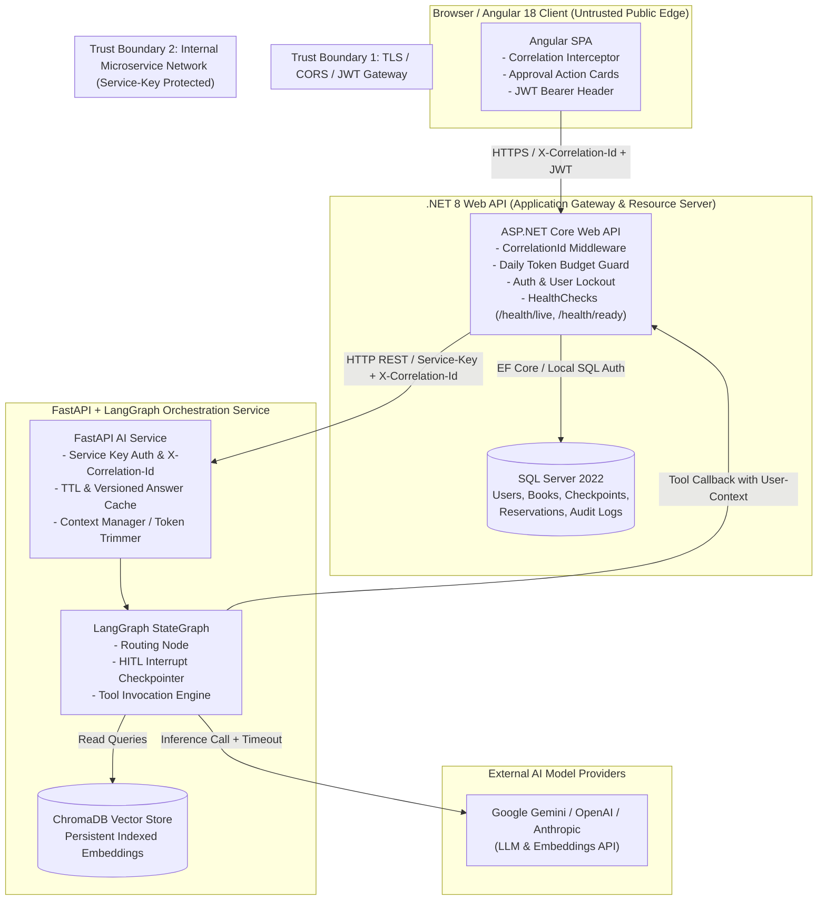

# 🏛️ Week 8: Capstone Final Polish, Performance, Reliability, Security & Packaging

**Program:** AI Software Development Internship (.NET + Angular + AI)  
**Author:** Muhammad Qasim  
**Milestone:** Week 8 of 8 (Final Capstone) — Production Hardening, Verification & Release  

[](https://dotnet.microsoft.com/)
[](https://angular.dev/)
[](https://fastapi.tiangolo.com/)
[](https://langchain-ai.github.io/langgraph/)
[](https://www.docker.com/)
[](https://github.com/)

---

## 🌟 Executive Overview

**Week 8 is the Capstone Milestone.** Having designed full-stack reactive applications, RAG pipelines, and autonomous LangGraph agents in Weeks 1–7, Week 8 tests something fundamentally different:  
*Can you take a complex system that runs on your local machine and transform it into a containerized, observable, hardened, and reproducible enterprise platform that another engineer or stakeholder can run, trust, measure, and maintain with a single command?*

### The Core Guarantees of Week 8
1. **Measured Performance & Caching:** Baselines measured first across 20 scenarios; optimizations verified with before/after latency, tokens, and cost. Pass rate must not regress.
2. **Reliability & Observability:** Unified `X-Correlation-Id` across Angular, ASP.NET Core, and FastAPI; liveness (`/health/live`) vs. readiness (`/health/ready`); explicit timeouts on every outbound hop.
3. **Defense-in-Depth Security:** Automated dependency vulnerability scans (`dotnet list package --vulnerable`, `npm audit`, `pip-audit`), whole-history Git secret scanning (`gitleaks`), locked-down CORS, login rate limiting, and GDPR-compliant `DELETE /api/me/data`.
4. **Zero-Friction Packaging:** Multi-stage Dockerfiles, non-root execution, container start ordering via healthchecks, and single-command startup (`docker compose up --build`).
5. **Quality Gates & Release:** 20-scenario evaluation harness executed 3 times, zero unapproved writes, approved release criteria, semantic versioning, and v1.0.0 release.

---

## 📐 System Architecture & Trust Boundaries



---

## 📂 Modular Structure & Capstone Parts

The capstone project is organized into structured, self-contained parts:

| Directory | Scope & Focus | Primary Deliverables |
| :--- | :--- | :--- |
| **[`Week_08_PartA_Audit/`](./Week_08_PartA_Audit/)** | System Audit & Architecture Decisions | Triaged backlog, Architecture Mermaid diagram, 3 ADRs, Pre-mortem failure analysis. |
| **[`Week_08_PartB_PerformanceCost/`](./Week_08_PartB_PerformanceCost/)** | Performance, Cost & Safe Caching | Baseline & optimized benchmarks, incremental indexing, safe answer cache, token budgets. |
| **[`Week_08_PartC_Reliability/`](./Week_08_PartC_Reliability/)** | Observability, Traces & Reliability | Distributed correlation IDs, liveness/readiness probes, failure injection matrix. |
| **[`Week_08_PartD_Security/`](./Week_08_PartD_Security/)** | Security Hardening & Peer Review | Dependency audits, gitleaks scan, strict CORS, login rate limits, `DELETE /api/me/data`. |
| **[`Week_08_PartE_DockerPackaging/`](./Week_08_PartE_DockerPackaging/)** | Multi-Container Packaging | Multi-stage Dockerfiles, `docker-compose.yml`, non-root users, volume mounts, seed scripts. |
| **[`Week_08_PartF_FinalEvaluation/`](./Week_08_PartF_FinalEvaluation/)** | 20-Scenario Evaluation & Release | Formal release criteria, 20-scenario x3 matrix, regression analysis, CHANGELOG.md. |
| **[`Week_08_PartG_Documentation/`](./Week_08_PartG_Documentation/)** | Documentation Suite & Video Walkthrough | Architecture guide, runbook, end-user guide, slide deck outline, walkthrough demo. |
| **[`Week_08_PartH_IncidentDrill/`](./Week_08_PartH_IncidentDrill/)** | Live Incident Response & Postmortem | Fault diagnosis runbook, blameless postmortem report, action items tracking. |
| **[`Week_08_PartI_GapMap/`](./Week_08_PartI_GapMap/)** | Curriculum Gap Map & 90-Day Roadmap | 8-week curriculum reflection, candidate self-assessment, 90-day learning roadmap. |

---

## 🛠️ Tooling & Environment Requirements

Consistent toolchain paths applied across development, CI, and local verification:
- **.NET SDK:** `D:\Software\dotnet\dotnet.exe` (.NET 8.0 SDK)
- **Python Virtualenv:** `D:\Software\PythonEnvironments\AI_env\Scripts\python.exe` (Python 3.12+)
- **Package Manager:** `D:\Software\PythonEnvironments\AI_env\Scripts\pip.exe`
- **Git Binary:** `D:\Software\Git\cmd\git.exe`
- **Container Engine:** Docker Desktop / Docker Compose v2.20+

---

## 🚀 Quick Start (Local & Containerized)

### 1. Environment Configuration
Copy the template configuration and supply the required API keys and secrets:
```bash
cp .env.example .env
```

### 2. Multi-Container Launch
Start all services (SQL Server, FastAPI AI Orchestrator, .NET Web API, and Angular Client) with automatic dependency health waiting:
```bash
docker compose up --build
```

### 3. Verification Endpoints
- **Angular Web Client:** `http://localhost:4200`
- **ASP.NET Core Web API:** `http://localhost:5000/swagger`
- **API Health Probes:** `http://localhost:5000/health/live` & `http://localhost:5000/health/ready`
- **FastAPI AI Engine:** `http://localhost:8000/docs` & `http://localhost:8000/health`
