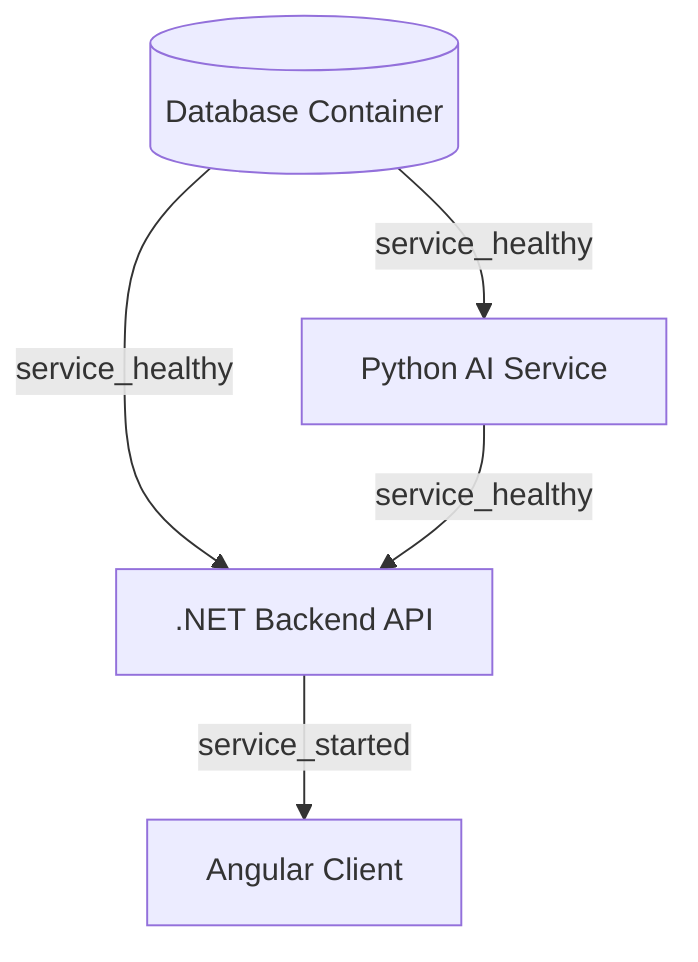

# ADR-004: Breaking Circular Startup Dependencies in Docker Compose

## Status
**Accepted** (Implemented in Week 8 Part E)

## Date
2026-10-23

## Context & Problem Statement
In the Nexa Solutions Library Architecture, the system topology exhibits a bidirectional service interaction during normal runtime operation:
1. **.NET Web API (`api`) calls Python AI Service (`ai-service`)**: When users send natural language queries or initiate LangGraph agent runs, the .NET API orchestrates the request, checks rate limits, and forwards the invocation to `ai-service:8000/agent/run`.
2. **Python AI Service (`ai-service`) calls .NET Web API (`api`)**: During agent execution, dynamic LangGraph tools (such as `check_book_availability` and catalog retrieval) issue HTTP REST requests back to `api:8080/api/books/{id}/availability`.

Docker Compose prohibits cyclic dependencies (e.g. `api` having `depends_on: [ai-service]` while `ai-service` also specifies `depends_on: [api]`). If configured circularly, `docker compose up` errors immediately with a circular dependency graph fault.

**Key Design Question to Answer:**
*How did we break the cycle, and what does each service do while the other is still starting?*

---

## Decision & Resolution Strategy

We resolved the circular dependency by separating **startup readiness (liveness/bootstrapping order)** from **runtime tool invocation (lazy invocation with resilient retries)**.

### 1. Concrete Startup Hierarchy in `docker-compose.yml`
We enforce a strict acyclic dependency tree:

1. **`db` (PostgreSQL / Relational Store)** boots first and validates readiness via `pg_isready`.
2. **`ai-service` (FastAPI + LangGraph)** boots independently of the .NET API:
   - It only depends on its local vector store (Chroma) and persistent SQLite checkpointer volumes (`aidata`).
   - Its healthcheck (`/health`) checks local process responsiveness and vector store reachability, requiring zero connections to .NET.
3. **`api` (.NET Web API)** boots after `db` and `ai-service` report `service_healthy`.
   - On startup, if `RUN_MIGRATIONS=true`, .NET applies schema migrations and seeds default users (admin, demo) and 16 books into the database.
4. **`web` (Angular SPA via Nginx)** starts after `api` is ready to accept incoming client traffic.

---

## What Does Each Service Do While the Other Is Starting?

### A. While .NET API is Still Starting / Bootstrapping:
1. **FastAPI (`ai-service`) Startup Phase:**
   - FastAPI loads its dependencies, loads the Chroma vector store, initializes embedding models, and marks `/health` as HTTP 200 OK.
   - It does **not** make any outbound calls to .NET at application startup.
2. **Tool Invocation Graceful Fallback:**
   - If an agent run is triggered before .NET has completely initialized its Kestrel endpoints, tool calls to `check_book_availability` do not crash the agent process.
   - The tool execution in `ai-services/main.py` is wrapped in an explicit `try...except` block with a 1.5s timeout. If .NET is unreachable (`ConnectionRefusedError` or timeout), the tool seamlessly falls back to the in-memory fallback availability dictionary `LOCAL_AVAILABILITY` without interrupting the conversation or failing the agent run.

### B. While AI Service is Still Starting:
1. **.NET Web API Startup Phase:**
   - .NET waits for `ai-service` to be `service_healthy` before marking its own readiness gate (`/health/ready`).
   - Its `/health/live` probe returns HTTP 200 immediately once Kestrel is listening, enabling container orchestrators to know the process is alive.
2. **Polly Resilience Policies:**
   - Outbound HTTP requests from .NET to `ai-service` are managed via a typed `HttpClient` configured with **Polly Transient Error Retries (exponential backoff)** and a **Circuit Breaker** (breaks after 3 consecutive failures for 30 seconds).
   - If the AI service is momentarily restarting, .NET catches transient faults, retries safely, and returns friendly HTTP 503 Service Unavailable / fallback responses to the frontend instead of unhandled exceptions.

---

## Consequences & Trade-Offs

### Positive Consequences:
- **Zero Startup Deadlocks:** `docker compose up --build` boots reproducibly from a cold state on any clean machine.
- **Fail-Safe Operation:** AI service tools degrade gracefully to local catalog state if backend endpoints experience temporary downtime.
- **Strict Separation of Concerns:** Database migrations and database seeding are centrally owned by .NET EF Core at startup, avoiding distributed migration conflicts.

### Negative / Mitigated Consequences:
- Tool execution against real-time relational inventory is dependent on .NET being reachable. However, since .NET starts within seconds following AI service readiness, the transient window is negligible.
