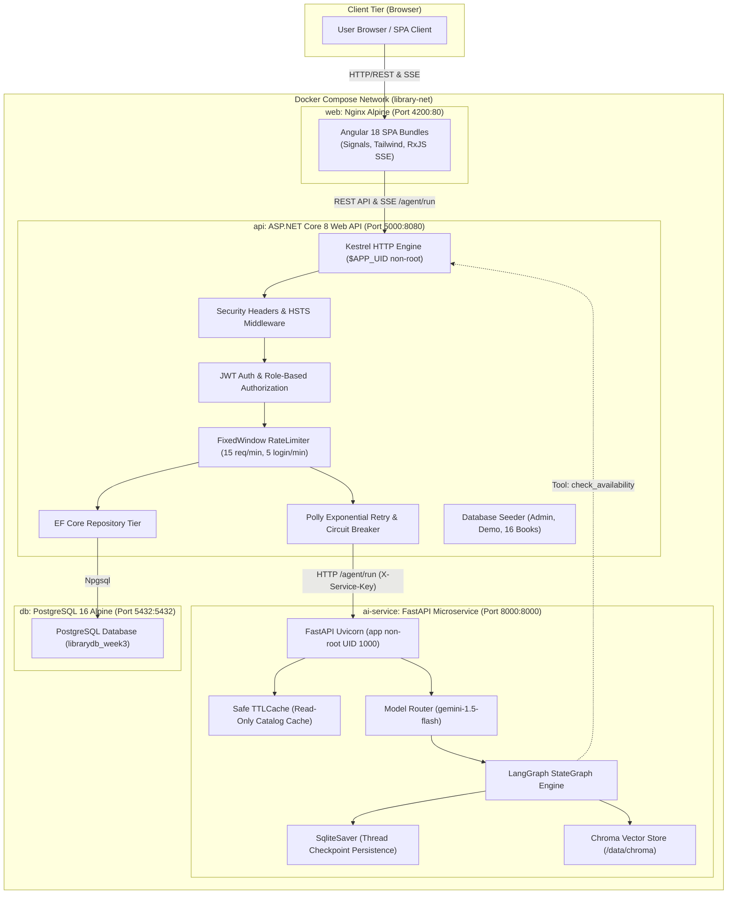
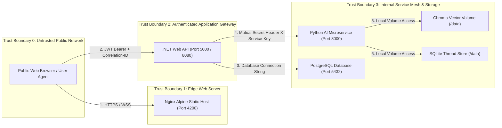
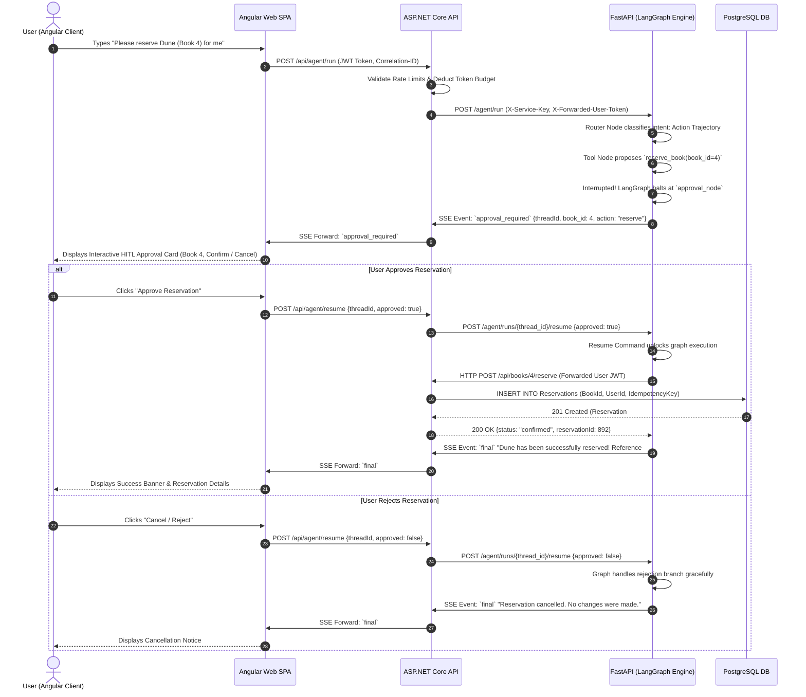

# System Architecture Specification

**Product:** Nexa Solutions AI Library System (Capstone Release v1.0.0)  
**Author:** Senior Systems Architect & Documentation Architect  
**Status:** Approved & Implemented  
**Date:** 2026-10-23  

---

## 1. System Overview

The Nexa Solutions Library System is an enterprise-grade, multi-tier, multi-agent AI web application. It integrates modern reactive frontend architecture, high-performance ASP.NET Core backend services, autonomous Python AI microservices powered by LangGraph, relational PostgreSQL persistence, and semantic vector retrieval with ChromaDB.

---

## 2. Component Topology & Container Mesh

The system is deployed as four decoupled microservices communicating across an isolated Docker bridge network (`library-net`):

---

## 3. Trust Boundaries & Security Enclaves

The architecture enforces four distinct trust boundaries to defend against lateral traversal and privilege escalation:

### Trust Boundary Rules
1. **Public vs. Edge (TB0 ➔ TB1):** Nginx serves compiled static Angular assets with strict Content Security Policy (`CSP`), anti-clickjacking (`X-Frame-Options: DENY`), and MIME sniffing prevention (`X-Content-Type-Options: nosniff`).
2. **Edge vs. Application Gateway (TB1 ➔ TB2):** Client invokes ASP.NET Core API using short-lived JWT Bearer tokens. Rate limiters defend against brute-force logins and agent flooding.
3. **Gateway vs. AI Service (TB2 ➔ TB3):** Direct external browser access to the Python AI service is prohibited in production. Inter-service HTTP calls require the internal pre-shared `X-Service-Key` header and forward user identity via `X-Forwarded-User-Token`.
4. **Non-Root Execution:** All application containers run as low-privileged users (`$APP_UID` in .NET, `app` UID 1000 in Python, `postgres` UID 70 in DB).

---

## 4. End-to-End Sequence: Human-in-the-Loop (HITL) Approval Run

The following sequence details an agent invocation executing a state-changing write (book reservation), illustrating the human approval card workflow and interrupted turn resumption:

---

## 5. Architectural Decision Records (ADRs)

Key architectural trade-offs are documented in formal ADRs:
- **[ADR-001: Separate FastAPI Microservice vs. In-Process Python](adr/ADR-001-separate-fastapi-service.md)** — Isolation of AI dependencies, independent scaling, and fault tolerance.
- **[ADR-002: SQLite Checkpointer vs. Shared PostgreSQL](adr/ADR-002-sqlite-checkpointer-vs-postgres.md)** — Thread state isolation and rapid schema-less turn resumption.
- **[ADR-003: Chroma Vector Store & Read-Only Catalog Caching](adr/ADR-003-chroma-vector-store-and-hitl-writes.md)** — Content-hash incremental indexing and zero-token safe caching.
- **[ADR-004: Breaking Circular Startup Dependencies in Compose](adr/ADR-004-breaking-circular-dependency.md)** — Decoupling container liveness from runtime tool dependencies.
